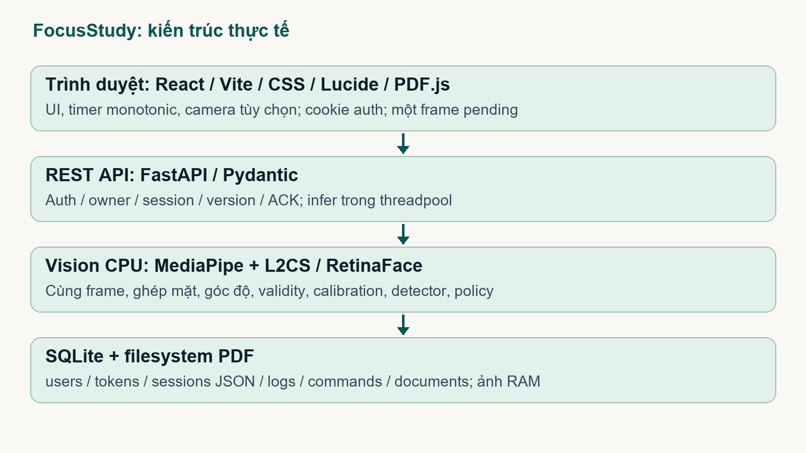
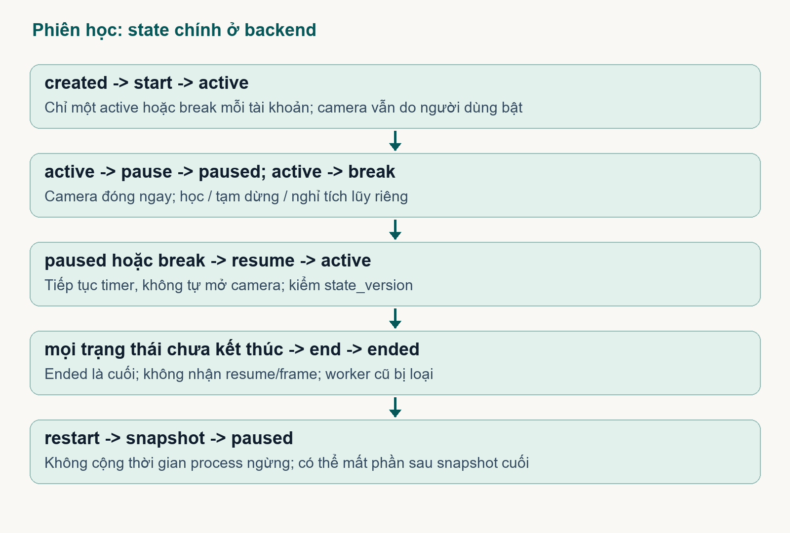
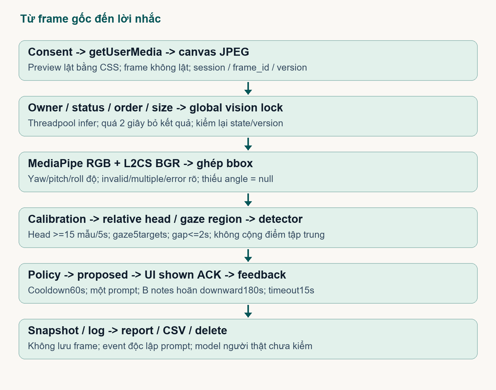
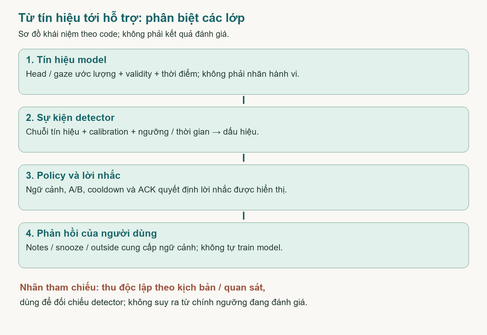
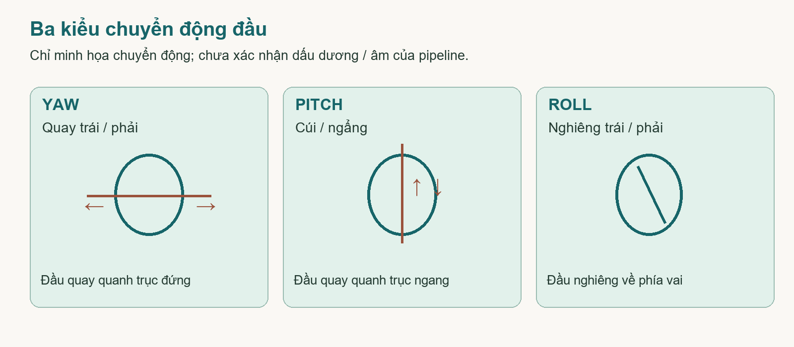
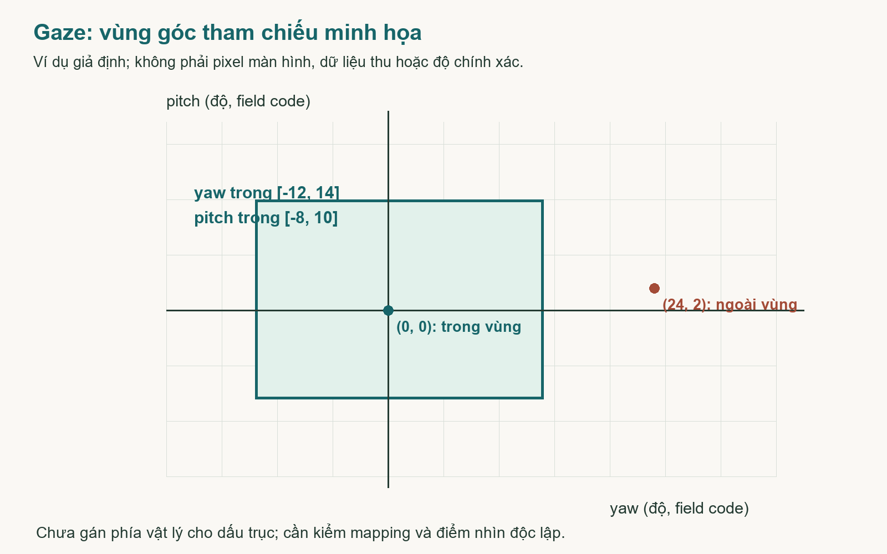
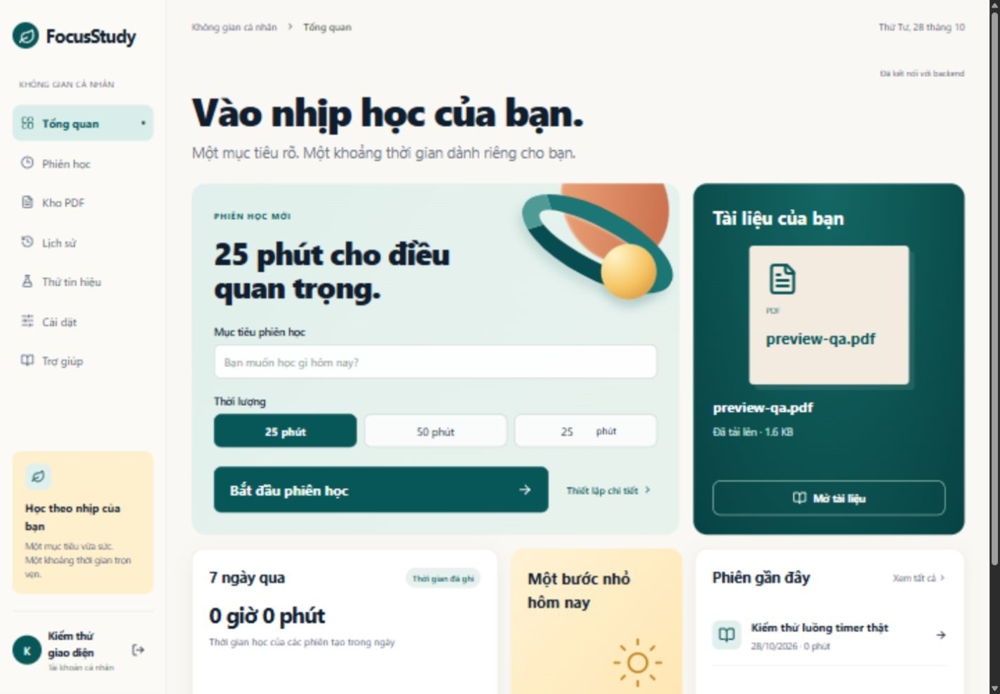
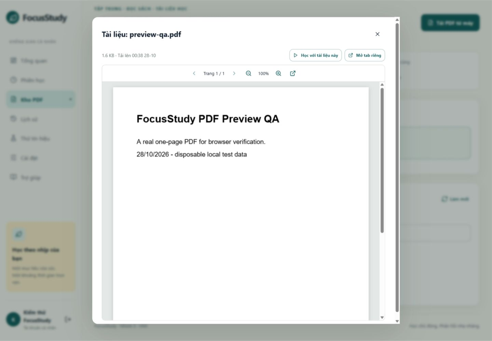
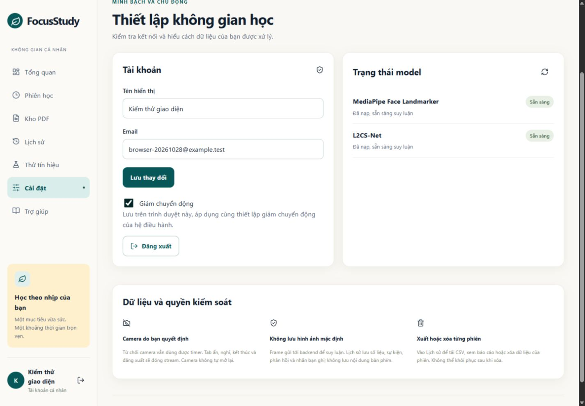

# FocusStudy - Báo cáo sản phẩm và bàn giao kỹ thuật

> 28/10/2026, Asia/Saigon. Nền Git6829e9c, feature/focusstudy-web, working tree có thay đổi. Không commit/push/deploy. Hai PDF nguồn là đặc tả/đề xuất, không phải kết quả hiện tại hoặc lệnh vận hành.

> Hướng dẫn đọc: chương 1 nắm hiện trạng; chương 4 hiểu hai model và cách tính; chương 9 chọn việc tiếp theo. Các phụ lục giữ chi tiết API, file và nghiệm thu.

**Báo cáo dành cho cả nhóm sử dụng và trình bày**

- Hiện trạng: chức năng đang có, bằng chứng đã kiểm và giới hạn.
- Cẩm nang model: ảnh đầu vào, công thức góc, mốc cá nhân, vùng gaze và cách đọc thông số.
- Việc tiếp theo: 10 gói việc, người phụ trách đề xuất, đầu ra và tiêu chí nghiệm thu.
- Tra cứu kỹ thuật: kiến trúc, pipeline, lưu trữ, API, nhiệm vụ file và ma trận yêu cầu.

**Điểm cần nhớ khi bảo vệ:** code đã có và model nạp được không chứng minh góc đã chính xác. Ngưỡng gán dấu hiệu, calibration và cách kết hợp head/gaze cần được kiểm độc lập trên người thật.

[TOC]

## 1. Phạm vi và mức sẵn sàng

FocusStudy giúp sinh viên tự tổ chức phiên học trên laptop: mục tiêu, thời lượng, đọc PDF, timer, camera tùy chọn, phản hồi lời nhắc, báo cáo/xuất/xóa. Tín hiệu đầu/mắt không là phép đo trực tiếp tập trung, hiểu bài hoặc thành tích. Không theo dõi nội dung ứng dụng khác, danh tính hay nội dung bàn phím.

Bản này có dashboard ivory/teal/mint theo 4 ảnh, components chung, PDF.js đọc trang thật, PDF ownership/dedup/reference cleanup, account đổi tên thật, giảm motion và FAQ search. Giữ adapter upstream, không thay bằng bản cũ. Dữ liệu thử ở tmp/browser và pytest tmp_path; data thật được giữ.

| Mức kiểm chứng | Đã có bằng chứng | Không chứng minh |
|---|---|---|
| Checkpoint |3 file, tổng 195.377.107 bytes, SHA256 ở model-smoke.json |Không suy ra model chạy |
| Model load |MediaPipe/L2CS available true, CPU |Không suy ra webcam/calibration/accuracy |
| Inference smoke |Adapter ảnh đen không mặt và gaze network forward crop tổng hợp finite |Không là mẫu người, accuracy hay benchmark webcam |
| Test logic |27 passed, 1 warning tại đợt kiểm; fixture DB/PDF riêng |Không thay kết quả model/nghiên cứu |
| Browser |Auth/timer/pause/resume/break/end/report/PDF có chữ/settings/help/focus |Chưa camera vật lý/Chrome-Edge độc lập |
| Nghiên cứu |Chưa pilot/evaluation/SUS |Không bịa số liệu hoàn thành |

Còn thiếu quan trọng: offline interval replay chính xác và audit mở rộng của khoảng thời gian phục hồi, calibration dwell/held-out người thật, audit runtime telemetry. MediaPipe smoke có portable_clearcut_uploader thử gửi telemetry thất bại mạng. [Privacy notice chính thức](https://developers.google.com/edge/mediapipe/solutions/tasks#mediapipe_tasks_privacy_notice) nêu SDK gửi metrics sử dụng/hiệu năng nhưng không gửi input đến Google; UI consent đã bổ sung giải thích, chưa network audit độc lập. Không đưa dữ liệu pilot thật vào trước khi giải quyết. Prototype chạy được, chưa nghiệm thu toàn bộ hoặc production-ready.

### 1.1 Cách đọc báo cáo theo công việc của nhóm

| Bạn cần làm gì? | Đọc trước | Sau khi đọc phải trả lời được |
|---|---|---|
| Nắm bản hiện tại để demo/thuyết trình | Chương 1, chương 4 và chương 9 | Bản này chạy được gì, model tính gì và phần nào còn là giả thuyết |
| Sửa frontend và trải nghiệm học | Chương 3, chương 6; các file frontend trong phụ lục | Trạng thái nào do backend xác nhận, khi nào phải đóng camera, lỗi hiển thị ra sao |
| Làm model và calibration | Chương 4; pipeline vision trong chương 3 | Mốc ở đâu, trục/đơn vị nào, nhãn nào do người xác nhận và cần thử gì |
| Làm backend, report và đồng bộ | Chương 3, chương 5, phụ lục API/schema | Cách bảo toàn thời gian, ownership, ACK, xóa và provenance |
| Thu thử, chọn ngưỡng và đánh giá | Chương 4 và các gói việc chương 9 | Thu bằng chứng nào, dùng dữ liệu nào để chỉnh, giữ gì riêng để đánh giá |

Báo cáo có hai loại câu: mô tả code hiện tại và đề xuất việc tiếp theo. Cấu hình đang tồn tại trong code không mặc nhiên là cấu hình đã được xác nhận đúng. Các ví dụ số trong phần giải thích model đều là minh họa, không được đưa vào bảng kết quả thực nghiệm của nhóm.

### 1.2 Tổng quan bản này trong một phút

Ứng dụng có hai đường sử dụng. Đường timer/PDF cho phép tạo mục tiêu, học, tạm dừng, nghỉ và xem báo cáo mà không cần camera. Đường hỗ trợ camera nhận frame tại backend cục bộ, chạy head/gaze, kiểm tra hiệu chỉnh và dùng luật để quyết định có hỏi người dùng hay không. Khi tắt camera hoặc nhánh model lỗi, không được tự biến thiếu dữ liệu thành mất tập trung.

| Hạng mục | Có trong code hiện tại | Bằng chứng và giới hạn |
|---|---|---|
| Tài khoản và lưu dữ liệu | Register/login, cookie, ownership, đổi tên, logout | Có test và một số luồng browser; chưa vận hành production |
| Không gian học | Dashboard, phiên, PDF reader, history/report, settings/help | Có ảnh thật và kiểm responsive; chưa mọi trình duyệt/screen reader |
| Timer và persistence | Active/break/paused, ACK/version, checkpoint nền 5 giây | Có test và live API; replay thời điểm offline đầy đủ còn thiếu |
| Runtime model | Ba checkpoint đã có, hai nhánh CPU nạp được | Có synthetic smoke; chưa webcam/calibration người thật |
| Luật hỗ trợ | Detector ngưỡng/thời gian, ưu tiên, cooldown, A/B notes, feedback/rating | Có code/replay fixture; ngưỡng và giá trị hỗ trợ chưa pilot |
| Nghiên cứu | Protocol và chỗ lưu log/annotations | Chưa có dữ liệu pilot/evaluation, chưa accuracy/SUS/hiệu quả học |

Con số 27 test đạt là kết quả kiểm thử phần mềm đã ghi ở đợt triển khai trước. Lượt cập nhật báo cáo này không chạy lại một nghiên cứu người dùng, không tạo thêm bằng chứng model trên người và không đổi logic ứng dụng. Test xác nhận code làm đúng trường hợp kiểm, không xác nhận mọi giả định của mô hình/quy tắc.

### 1.3 Đóng góp của nhóm nằm ở đâu?

| Thành phần dùng lại | Phần nhóm tự xây quanh nó | Giá trị cần kiểm chứng tiếp |
|---|---|---|
| React/Vite/Lucide/PDF.js | Luồng học, trạng thái lỗi, quyền camera, timer/PDF, báo cáo | Người dùng thao tác hiểu và chủ động kiểm soát được |
| MediaPipe Face Landmarker | Tách góc, mốc đầu, validity, ghép mặt, detector head | Trục/góc có ý nghĩa và dấu hiệu không nhắc sai quá mức |
| L2CS pretrained | Tích hợp preprocessing, ánh xạ góc, vùng gaze, cổng tư thế | Gaze bổ sung thông tin hữu ích ở trường hợp head không đủ |
| FastAPI/SQLite | Session/ACK/version, lưu log, policy A/B, report/export/delete | Nhất quán, bảo toàn dữ liệu và truy vết được quyết định |

Không nên trình bày nhóm đã tự huấn luyện hai model hoặc model tự hiểu người học đang ghi chép. Điểm tự phát triển là hệ thống tích hợp và tương tác quanh các ước lượng: kiểm dữ liệu, hiệu chỉnh, luật theo thời gian, hỏi ngữ cảnh và trao quyền tắt/nghỉ cho người dùng. Hiệu quả của cách hỗ trợ đó vẫn là giả thuyết cần đánh giá.

### 1.4 Những câu nên dùng và cần tránh khi trình bày

| Nên nói | Cần tránh |
|---|---|
| Bản prototype đã chạy được các luồng web và có kiểm thử logic | Đã hoàn thiện toàn bộ hệ thống hoặc production-ready |
| Góc và hướng nhìn là giá trị ước lượng cần kiểm chứng | Đo chính xác góc đầu/mắt hoặc biết chắc đang nhìn đâu |
| Ngưỡng 25/20 độ là cấu hình khởi tạo đang thử | Model cho biết 25 độ là ngưỡng mất tập trung |
| Calibration hiện đạt điều kiện thu mẫu của code | Calibration đã được chứng minh chính xác trên người dùng |
| Phản hồi ghi chép điều chỉnh chính sách B trong phiên | Feedback đang train lại model hoặc tăng accuracy |
| Số prompt và tỷ lệ hợp lệ là số liệu vận hành | Số prompt ít hoặc validity cao chứng minh học tốt hơn |

Trước mỗi demo, người trình bày cần nói rõ đang dùng camera thật hay fixture. Trong report này, synthetic smoke nghĩa là chạy kỹ thuật trên ảnh/crop tổng hợp đã ghi nhãn rõ, không phải một phiên học của người dùng.


## 2. Công nghệ và kiến trúc

Node >=22.13 theo PDF.js (máy này24.22.1). Frontend React19/Vite6/CSS/Lucide JavaScript JSX; giữ auth/API hiện có. PDF.js được lazy load qua Suspense; worker render canvas để không phụ thuộc PDF viewer trình duyệt. Backend FastAPI/Pydantic/SQLite/numpy/Pillow/pypdf; vision optional MediaPipe/PyTorch CPU/L2CS. Phiên bản khai báo trong requirements/package.json, thực cài ở evidence/environment.json và phụ lục.



Giữ REST POST /frames tuần tự thay WebSocket/TypeScript đề xuất trong PDF. Một frame pending phía client và global vision_lock; infer ở threadpool, model nạp một lần qua lifespan. Chỉ một uvicorn worker vì trạng thái/khóa trong process. SQLite đủ demo cục bộ; không tự thêm cloud/production. DECISIONS.md ghi khác biệt đầy đủ.

## 3. Pipeline chi tiết

### 3.1 Auth và tài khoản

Auth form nhận name/email/password và giữ dữ liệu khi lỗi. Register chuẩn hóa email; password scrypt salt16bytes n16384/r8/p1; DB lưu salt:hash. Login dùng hmac.compare_digest. Token random32bytes; DB lưu SHA256 và expires7ngày. Cookie HttpOnly, SameSite=Lax, Secure khi COOKIE_SECURE=1. Không tài khoản mặc định.

Dependency user kiểm cookie focusstudy hoặc query token upstream; join tokens/users, hết hạn401. Ownership qua user_id khi load session/document. PATCH auth/me chỉ sửa tên1-80ký tự, trim và từ chối trắng; email readonly. Logout thu hồi token cookie hiện tại, pause phiên active/break, frontend dừng stream. Chưa reset password/email verification/rate limiting; query token và loopback-origin guard cần hardening nếu đổi môi trường.

### 3.2 Session, timer, ACK và recovery

NewSession kiểm goal1-300/duration1-240phút/mode reading-exercise-watching/A-B/document owner. Tạo UUID và snapshot created. Start/resume chỉ cho một phiên active/break mỗi user; phiên created/paused khác được giữ. Timer độc lập camera và không tự kết thúc khi về0, cho người dùng chọn end.



accrue dùng delta time.monotonic, tích lũy active/break/paused riêng. view cập nhật và lưu snapshot. React hiển thị active_seconds cộng performance.now delta; interval chỉ render, không đếm cộng từng tick. Poll5s cập nhật snapshot; reload đọc sid sessionStorage rồi GET. Camera không tự mở lại.

Create có request_id tùy chọn để retry cùng ý định không tạo trùng phiên; frontend giữ ID đến start ACK. Command có event_id và expected_state_version tùy chọn; trùng ID không áp lại; version cũ409. Log command, snapshot và ID ACK ghi cùng transaction. End là trạng thái cuối, tắt support/prompt/counters và tăng version. Worker kiểm lại state/version sau infer, loại kết quả sau pause/end/delete.

Restart load DB: active/break về paused, support false, hủy prompt/counters/frame/calibrating/deadlines, tick mới, tăng version và log recovery. Không cộng khoảng process ngừng; có thể mất thời gian sau snapshot cuối. Backend có checkpoint5s và khi shutdown, độc lập client; khoảng sau snapshot cuối vẫn có thể mất nếu hardcrash.

Mất backend: stop camera, timer cục bộ, báo chưa sync. Lệnh mạng lỗi giữ event_id/version trong sessionStorage theo user; bấm thử đồng bộ rõ ràng, conflict tải snapshot để kiểm tra. Chưa tái dựng thời điểm pause offline, backend áp lệnh lúc nhận. Không gọi phục hồi chính xác; không âm thầm sửa version để replay hồi sinh ended.

### 3.3 PDF và lưu file

Upload multipart hoặc raw, giới hạn100MB, kiểm đuôi/magic và PdfReader cấu trúc/có trang/không mã hóa. session_id nếu có phải thuộc owner trước ghi. SHA256 dedup content theo user, retry cùng nội dung trả tài liệu cũ; frontend không retry raw sau multipart lỗi mơ hồ. File UUID+tên lọc trong DOCS_DIR; DB metadata/path/bytes/timestamp/hash.

Create/attach/read/delete đều kiểm document ownership; snapshot giữ document_id/name. documents.session_id chỉ là liên kết gần nhất, không phải đầy đủ quan hệ nhiều-nhiều. Nhiều snapshot có thể dùng cùng PDF.

PdfReader load file với cookie, worker PDF.js, ResizeObserver fit width, devicePixelRatio tối đa2; prev/next biên disable, zoom50-200%, loading/error/retry và file gốc. Hủy task/render khi unmount/đổi tài liệu. Canvas chưa text layer/chọn chữ/screen reader PDF. IAB đã nhìn thấy chữ thật; không suy ra Chrome/Edge độc lập đã QA.

Xóa PDF dưới lock: unlink trước, lỗi503 giữ DB/reference. Thành công thì transaction xóa metadata và dọn snapshot JSON của cùng owner, tăng version; cập nhật RAM sau commit. Không nuốt lỗi unlink. Crash giữa unlink và commit còn cần tombstone/reconciliation vì filesystem và SQLite không nguyên tử cùng nhau. Xóa session giữ kho PDF nhưng dọn documents.session_id.

### 3.4 Camera, preprocessing và inference

Consent trước getUserMedia; audio false,640x480 gợi ý. Chỉ preview CSS lật, frame canvas RGB gốc không lật. Scheduler350ms khi active/tabhiện/video ready, một frame pending; backend cùng frame_id cho hai model. Decode Base64/Pillow, chặn ảnh trên1920x1080, owner/version/order guards, model busy429; inference threadpool quá2s409 và reset counters/prompt.



Frontend generation/current id/version bỏ kết quả cũ; stopCamera dừng track/srcObject/signal ngay khi off/pause/break/end/logout/rời màn học/tabẩn/error. Watchdog không kết quả mới2.5s đóng camera, yêu cầu bật lại. Backend support/version guards bổ sung; không tự mở sau resume/reconnect. Camera vật lý chưa xin quyền/thử ở lượt này.

MediaPipe FaceLandmarker num_faces2, output transform true. Một mặt -> bbox landmarks; rotation3x3 tách SVD, sửa determinant, Euler yaw/pitch/roll độ. Giữ bbox fallback upstream khi thiếu transform để ghép gaze; head lúc đó invalid. Multiple/absent không dùng head, roll không nhắc.

L2CS Pipeline ResNet50/90bins, Gaze360 pretrained. RetinaFace dependency cắt mặt threshold0.5; BGR->RGB, resize224 rồi transformations Resize448/ToTensor/Normalize ImageNet mean0.485/0.456/0.406,std0.229/0.224/0.225. Softmax kỳ vọng bin*4-180 -> radian; adapter đổi degree. Một bbox ghép MediaPipe bằng IoU>=0.15 hoặc tâm gần theo bbox. Không mặt/nhiều mặt/không khớp -> invalid, không confidence tổng hoặc trừ cơ học head khỏi gaze. Preprocessing được đọc package thực cài, không suy đoán từ tên model.

### 3.5 Calibration và validity

Head >=15mẫu hữu hạn/5s; std15mẫu gần nhất<=7.5độ; median baseline. Relative wrap(x-baseline+180)%360-180. Thiếu/dao động trả422 với progress. Bật lại support reset profile.

Gaze center/left/right/top/bottom mỗi3mẫu, tổng>=5s; percentile5/95 mở rộng5độ làm vùng. Giữ auto progress/complete upstream; UI marker đúng mục tiêu backend gần biên màn hình và progress mẫu thật. Chưa dwell/confirm người đã nhìn đúng, chưa held-out/overlap; profile.valid chỉ điều kiện code, không chất lượng đã xác nhận.

Gaze quyết định chỉ khi head đã calibrated gần baseline trong15độ và gaze profile có. Giới hạn posture này cần thử người; chưa được gọi verified về thực nghiệm. Gaze lỗi vẫn dùng head độc lập. Invalid angle API là null, không0. Không thêm EMA khi chưa pilot chọn tau. Gap>2s reset detector.

### 3.6 Detector, fusion, policy và feedback

policy.evaluate dùng timestamp liên tục; false/invalid/gap>2s/sai thứ tự reset. head_turn |yaw|>25độ8s; head_down pitch theo HEAD_DOWN_SIGN>20độ15s đọc/xem hoặc25s bài; gaze ngoài vùng8s nếu head posture đủ; face_not_observed khi frame mới vẫn đến nhưng MediaPipe absent10s. Không frame không được coi absent.

Ưu tiên absent -> head -> gaze, một prompt, không điểm tập trung hoặc queue cũ. detector_event start có ID/start_at/eligible_at/frame/version, detector_event_end ghi end_at/duration_seconds tại mẫu cuối đã quan sát, không nối qua gap. Các lý do blocked (calibrating/active_prompt/snoozed/cooldown/downward_snoozed) log khi đổi, độc lập prompt; prompt liên kết evidence_event_ids. Chưa đánh giá chất lượng sự kiện trên người. Cooldown60s từ prompt_shown ACK, không proposed. Timeout15s expired; late feedback409 không tác động policy.

| Action | Cả A/B | Riêng B |
|---|---|---|
|return|Đóng prompt,reset counters,giữ cooldown|Không |
|notes|Ghi ngữ cảnh/đóng|Downward head+gaze-down hoãn180s |
|outside|Support off/camera đóng/hoãn300s|Không |
|snooze|Mọi nhắc hoãn180s|Không |
|break|Nghỉ/support off/camera đóng|Không |
|timeout|Tự ẩn15s,không xác nhận/rating|Không |

Rating bool hữu ích endpoint riêng sau shown, một rating mỗi prompt. Không train model từ feedback/rating. A/B cùng defaults/model/calibration, timer-only không là baseline A nghiên cứu. Ngân sách nghỉ gợi ý duration/3 hiển thị, không cưỡng chế quay lại; mẫu số cần nhóm chốt.

### 3.7 Report, CSV, delete và dữ liệu thiếu

Report đọc logs theo id, gom prompt theo ID. prompt_count=shown log, feedback_count=feedback hợp lệ, response_rate=feedback/shown hoặc null; helpful_ratio=rating true/rating_count hoặc null. head/gaze_valid_ratio là tỷ lệ mẫu hợp lệ, không accuracy. Timeline từ command; annotations/calibrations/rating riêng.

Phiên schema1 có missing seconds trong active. Nhánh calibrated+valid có hiệu lực mẫu tối đa2s; camera covered khi ít nhất một nhánh đủ. Không cộng head-missing+gaze-missing; thiếu là phần của active, không cộng thêm vào tổng phiên. Camera off vẫn học timer nên thiếu hỗ trợ. Snapshot cũ không có coverage thì chưa được ghi, không hồi suy lịch sử.

CSV UTF8 BOM có time_utc_epoch/type/frame_id, head/gaze yaw-pitch_deg, validity, active/break/paused/missing_seconds, goal và data_json. Summary row mang tổng; dòng signal mang góc. Null trong cột phẳng để rỗng, JSON vẫn null. Ô text có ký tự công thức đầu dòng được thêm dấu nháy đơn, kể cả khoảng trắng trước công thức; test formula defense đã chạy. Export không ảnh. API/BOM đã kiểm; browser download event timeout nên chưa xác nhận file tải UI.

Delete session dưới lock: RAM ended/supportfalse/version++, transaction xóa sessions/commands/dọn documents.session_id; logs cascade FK. states pop. Worker reference cũ thấy ended/version đổi ->409 trước ghi, không hồi sinh. Regression dùng worker chờ thật với infer stub để kiểm race, không model quality.

## 4. Cẩm nang hai model: góc được tính thế nào và dùng được đến đâu?

Chương này dùng để học, thuyết trình và tổ chức kiểm thử. Công thức mô tả đúng luồng đang có trong code; chúng không phải bằng chứng rằng góc đã đo chính xác trên người dùng. Những con số minh họa dưới đây được đặt để giải thích phép tính, không phải dữ liệu thực nghiệm hoặc benchmark.

### 4.1 Sáu khái niệm phải phân biệt

| Khái niệm | Hiểu đơn giản | Ví dụ trong FocusStudy |
|---|---|---|
| Checkpoint | File chứa trọng số đã huấn luyện trước | face_landmarker.task và L2CSNet_gaze360.pkl; file safetensors là bản trọng số khác định dạng |
| Inference | Chạy model trên đầu vào để có dự đoán | Một ảnh khuôn mặt đi qua pipeline để có góc và validity |
| Calibration | Đặt mốc hoặc vùng tham chiếu cho phiên/người dùng | Mốc đầu khi nhìn giữa màn hình; vùng góc gaze khi nhìn các mục tiêu |
| Nhãn tham chiếu | Mô tả hành vi/mục tiêu do kịch bản, người quan sát hoặc người dùng xác nhận | turn_left, notebook, writing_notes; có thể uncertain |
| Sự kiện detector | Dấu hiệu suy ra từ chuỗi tín hiệu và cấu hình | head_turn đủ ngưỡng liên tục; khác nhãn người gán |
| Quyết định hỗ trợ | Có hiển thị lời nhắc hay tiếp tục quan sát | Bị chặn do cooldown; hoặc hỏi người dùng đang ghi chép không |

Không lấy ngưỡng đang thử để tạo nhãn chuẩn rồi dùng chính nhãn đó chứng minh ngưỡng đúng. Ví dụ, tự gán mọi mẫu yaw lớn hơn 25 độ là quay đầu, sau đó đánh giá detector 25 độ trên nhãn đó sẽ tạo đánh giá vòng tròn.



### 4.2 Yaw, pitch, roll là gì? Mốc 0 không phải một thứ duy nhất

Yaw mô tả thành phần quay trái/phải; pitch mô tả cúi/ngẩng; roll mô tả nghiêng đầu. Đây là cách gọi trực quan. Muốn dùng dấu dương/âm để gán bên trái/phải hoặc cúi/ngẩng, nhóm phải xác nhận quy ước trục, phía nhìn và thứ tự Euler của pipeline cụ thể.



| Loại mốc | Ý nghĩa thực tế | Điều không được suy ra |
|---|---|---|
| Mốc hình học của pipeline | Hệ tọa độ và khuôn mặt chuẩn mà phép biến đổi/model sử dụng | Góc thô bằng 0 không bảo đảm người học đang nhìn giữa màn hình |
| Mốc đầu cá nhân | Tư thế đầu ước lượng khi người học nhìn giữa màn hình trong lần hiệu chỉnh | Không phải phép đo góc đầu vật lý có độ chính xác đã biết |
| Vùng gaze tham chiếu | Khoảng các giá trị gaze dự đoán khi nhìn mục tiêu trên màn hình | Không phải hình chữ nhật màn hình tính bằng pixel hoặc cm |
| Ngưỡng detector | Mức lệch và thời gian do nhóm chọn để thử phát hiện dấu hiệu | Không phải đầu ra hoặc khuyến nghị tự động của model |

Camera đặt lệch, thay khoảng cách, đổi vị trí ghế hoặc đổi màn hình có thể làm mốc cũ không còn phù hợp. Khi bật lại hỗ trợ, code hiện xóa profile để thu lại. Đây là quy tắc vận hành; chất lượng của lần thu mới vẫn cần kiểm tra.

### 4.3 MediaPipe: từ ảnh tới ma trận và góc đầu

MediaPipe Face Landmarker cung cấp điểm mốc và ma trận biến đổi khuôn mặt. Trong dự án, góc head là kết quả của bước xử lý hình học do adapter thực hiện, không phải một nhãn hành vi mà MediaPipe trả sẵn. Tham khảo phần mô tả đầu ra trong [tài liệu MediaPipe](https://developers.google.com/edge/mediapipe/solutions/vision/face_landmarker); công thức triển khai cụ thể nằm trong vision/adapters.py.

Luồng thực tế: ảnh RGB không lật -> Face Landmarker -> đếm mặt -> lấy ma trận -> tách phần xoay -> đổi thành yaw/pitch/roll. Một mặt là điều kiện của nhánh head; không mặt, nhiều mặt hoặc thiếu ma trận thì head không có góc hợp lệ. Không tự điền góc 0 khi thiếu.

Ma trận biến đổi có cả thông tin ngoài phép xoay. Code lấy khối 3 x 3 đầu, gọi là M, rồi phân rã SVD để tìm ma trận xoay trực chuẩn gần nó. Ký hiệu Vt bên dưới chính là V chuyển vị; numpy.linalg.svd trả trực tiếp Vt.

```text
M = ma_tran_bien_doi[0:3, 0:3]
U, S, Vt = svd(M)
Nếu det(U @ Vt) < 0: đổi dấu cột cuối của U
R = U @ Vt
```

S có thể chứa thành phần co giãn; bước này không dùng S khi dựng R. Sửa determinant để tránh giữ một phép phản xạ thay cho phép xoay. Dấu @ là nhân ma trận, không phải nhân từng ô. SVD làm phép tách hình học có cơ sở; nó không tự chứng minh ma trận dự đoán sát với tư thế thật.

Với R là ma trận xoay, code dùng các công thức sau. Chỉ số bắt đầu từ 0 như trong Python; atan2 trả radian, còn degrees đổi sang độ.

```text
pitch_rad = atan2(R[2,1], R[2,2])
yaw_rad   = atan2(-R[2,0], sqrt(R[2,1]^2 + R[2,2]^2))
roll_rad  = atan2(R[1,0], R[0,0])
angle_deg = angle_rad * 180 / pi
```

Đây là một cách tách Euler cụ thể. Tên yaw/pitch/roll và chiều dương phải được kiểm tra bằng chuyển động có chỉ dẫn, không được xác nhận chỉ vì công thức chạy hoặc tên biến trông hợp lý. Khi chuyển qua các góc đặc biệt, Euler có thể đổi biểu diễn hoặc nhảy qua biên; cần đọc chuỗi và quy ước, không chỉ một mẫu.

Code còn dùng bbox từ landmarks để ghép mặt với L2CS, kể cả khi ma trận head không có. Vì vậy có bbox không đồng nghĩa có góc head; chức năng ghép mặt và chức năng đo tư thế là hai việc khác nhau.

### 4.4 Mốc đầu cá nhân, độ lệch và vòng góc

Trong backend/app.py, complete_calibration nhận các mẫu yaw/pitch hợp lệ đã thu. Với head, nó lấy 15 mẫu gần nhất và trung vị riêng từng trục. Điều kiện thu hiện tại gồm tổng ít nhất 15 mẫu, thời gian ít nhất 5 giây và độ lệch chuẩn của 15 mẫu gần nhất không vượt 7,5 độ ở mỗi trục. Đây là điều kiện do ứng dụng đặt, chưa được pilot chứng minh tối ưu.

```text
yaw0   = median(15 giá trị yaw gần nhất)
pitch0 = median(15 giá trị pitch gần nhất)

relative_yaw   = (yaw - yaw0 + 180) % 360 - 180
relative_pitch = (pitch - pitch0 + 180) % 360 - 180
```

Trung vị giúp giảm ảnh hưởng của một số mẫu lệch, nhưng code đang dùng trung vị tuyến tính. Nếu các mẫu nằm sát hai phía +180 và -180, cần kiểm tra cách lấy mốc theo góc vòng; không được cho rằng phép trừ có wrap đã tự giải quyết mọi vấn đề của bước chọn mốc.

| Ví dụ minh họa | Phép tính | Cách hiểu đúng |
|---|---|---|
| yaw0 = 12 độ; yaw = 40 độ | relative_yaw = 28 độ | Lệch 28 độ theo số đo ước lượng của pipeline so với mốc cá nhân |
| yaw0 = 179 độ; yaw = -179 độ | Sau wrap, độ lệch = 2 độ | Không đọc thành một chuyển động quay 358 độ |
| 15 mẫu gần giống nhau | Độ lệch chuẩn nhỏ | Có vẻ ổn định; vẫn có thể cùng bị sai lệch so với tư thế thật |

Không có thiết bị/tham chiếu đo góc độc lập thì ví dụ 28 độ trên không chứng minh đầu thật đã quay đúng 28 độ. Khi trình bày, nên nói độ lệch góc đầu ước lượng so với mốc cá nhân. Roll được ghi để xem tư thế; policy hiện không dùng roll làm lý do nhắc riêng.

### 4.5 L2CS: từ ảnh mặt tới góc gaze dự đoán

L2CS dùng trọng số pretrained Gaze360 và kiến trúc ResNet50 trong package đang cài. Nó không được dự án train lại từ phản hồi Đang ghi chép. Hai nhánh của mạng tạo đầu ra cho hai thành phần góc gaze; cần xác minh cách ánh xạ trục của checkpoint và pipeline cụ thể trước khi sử dụng ý nghĩa ngang/dọc.

Luồng preprocessing thực cài: adapter chuyển RGB sang BGR cho Pipeline.step; RetinaFace tìm và cắt mặt; pipeline đổi crop về RGB, resize 224 x 224; transformations tiếp tục Resize(448), chuyển tensor và chuẩn hóa ImageNet. Vì có hai bước resize, không nên trình bày đầu vào mạng cuối chỉ là 224 x 224. Package cục bộ pipeline.py và utils.py là căn cứ mô tả bản đang chạy.

```text
pixel_rgb trong [0,255]
x = pixel_rgb / 255
x_norm[channel] = (x[channel] - mean[channel]) / std[channel]
mean = [0.485, 0.456, 0.406]
std  = [0.229, 0.224, 0.225]
```

Mỗi thành phần góc có 90 giá trị logits. Softmax chuyển chúng thành các trọng số p_i không âm có tổng bằng 1. Pipeline lấy kỳ vọng chỉ số bin, rồi ánh xạ sang góc. Đây là 90 bin của đầu ra góc, không phải 90 lớp hành vi.

```text
i chạy từ 0 đến 89; z_i là logit của bin i
m = max(z_0, ..., z_89)
p_i = exp(z_i - m) / sum(exp(z_j - m), j=0..89)
expected_bin = sum(p_i * i)
theta_deg    = expected_bin * 4 - 180
theta_rad    = theta_deg * pi / 180
```

Adapter dự án nhận radian từ pipeline rồi dùng numpy.degrees để trả lại degree. Chuyển độ -> radian -> độ không làm góc chính xác hơn; cần bảo đảm không đổi đơn vị hai lần ở chỗ khác. Công thức bin cũng có trong [pipeline L2CS upstream](https://github.com/Ahmednull/L2CS-Net/blob/main/l2cs/pipeline.py); code package thực cài quyết định hành vi của bản này.

Trừ m trước khi lấy exp giúp tính ổn định số; không đổi kết quả softmax về mặt toán học. p_i là trọng số cho bin góc trong mô hình, không phải xác suất người dùng mất tập trung.

Ví dụ minh họa: nếu hai bin 44 và 45 có trọng số bằng nhau, còn các bin khác bằng 0, expected_bin là 44,5 và góc là -2 độ. Một phân bố có thể tạo số thập phân dù bước ánh xạ bin là 4 độ. Số lẻ không phải chứng nhận sai số nhỏ hơn 1 độ. Theo đúng công thức trên, các tâm bin được ánh xạ từ -180 đến 176 độ; đây không phải cam kết model đáng tin trên toàn khoảng đó.

Góc gaze là hướng nhìn ước lượng theo quy ước model. Nó không phải tọa độ điểm nhìn, cũng không tự cho biết người dùng đang đọc PDF, nhìn điện thoại hoặc đang mất tập trung. Khuôn mặt có thể bị phát hiện sai hoặc crop sai; khi đó một cặp góc hữu hạn vẫn chưa đủ để sử dụng.

### 4.6 Điểm cần audit trước tiên: thứ tự yaw/pitch và chiều góc

Đọc package đã cài cho thấy model.forward() trả hai tensor có tên pre_yaw_gaze, pre_pitch_gaze; predict_gaze() lại nhận chúng vào biến gaze_pitch, gaze_yaw. GazeResultContainer và adapter tiếp tục dùng các trường pitch/yaw tương ứng. Đây là khác biệt tên cần điều tra, chưa đủ để kết luận chắc chắn bị đảo trục vì quy ước nhãn khi training/checkpoint có thể khác tên lớp.

| Câu hỏi phải trả lời | Cách kiểm tra cần làm | Bằng chứng phải lưu |
|---|---|---|
| Tensor nào là trục ngang/dọc thực tế? | Đối chiếu training/dataset conventions và checkpoint; thử nhìn ngang/dọc khi đầu giữ gần mốc | Bảng mapping từ tensor đến field, code nguồn/version và log thử |
| Dấu nào là trái/phải/cúi/ngẩng? | Kịch bản có chỉ dẫn theo phía người học; preview lật và ảnh gốc phải được phân biệt | Quy ước trục kèm hình camera/người học, mẫu đúng và lỗi |
| Giá trị nào đã là radian/degree? | Theo dõi qua predict_gaze -> GazeResultContainer -> Vision.infer | Ví dụ đối chiếu chuyển đơn vị, không gán số đo đó là ground truth |

Không sửa nóng package trong .venv chỉ bằng cách đổi tên biến; cài lại sẽ mất sửa, và có thể làm sai checkpoint đang dùng. Khi có bằng chứng, nhóm mới chốt mapping trong adapter của dự án và bổ sung regression test. Lượt bổ sung báo cáo này không thay đổi mapping, model hay runtime ứng dụng.

Các biến HEAD_DOWN_SIGN và GAZE_DOWN_SIGN hiện mặc định 1. Chúng là lựa chọn cấu hình về chiều cúi, không phải dấu đã được xác nhận bằng người thật. Đổi dấu để làm demo trông đúng mà không ghi điều kiện thử sẽ không tạo bằng chứng kiểm chứng.

### 4.7 Mốc gaze là một vùng góc, chưa phải mặt phẳng màn hình

Code thu gaze tại center, left, right, top, bottom; mỗi mục tiêu cần ít nhất 3 mẫu hợp lệ, tổng thời gian ít nhất 5 giây. Vùng dùng cho quyết định hiện được tính từ tất cả mẫu, không phải một phép biến đổi hình học màn hình hoặc một bộ hồi quy điểm nhìn.

```text
yaw_min   = percentile(all_yaw, 5)  - 5
yaw_max   = percentile(all_yaw, 95) + 5
pitch_min = percentile(all_pitch, 5)  - 5
pitch_max = percentile(all_pitch, 95) + 5

inside = yaw_min <= yaw <= yaw_max
         và pitch_min <= pitch <= pitch_max
outside = không inside
```

Percentile 5 và 95 lấy hai đầu khoảng phân bố; cộng/trừ 5 độ mở rộng vùng để có dung sai. Ba lựa chọn 5%, 95% và 5 độ là heuristic khởi tạo. Chưa có dữ liệu chứng minh chúng phù hợp cho màn hình, khoảng cách hoặc từng người. Một hình chữ nhật quanh các mẫu giữa/biên có thể còn nhận cả các hướng ngoài màn hình hoặc bỏ sót góc màn hình chưa thu.



Ví dụ minh họa: nếu P05(yaw) = -7 và P95(yaw) = 9 thì khoảng yaw sau mở rộng là [-12,14] độ. Nếu P05(pitch) = -3 và P95(pitch) = 5 thì khoảng pitch là [-8,10] độ. Mẫu (0,0) nằm trong hình chữ nhật này; mẫu (24,2) nằm ngoài. Không được từ ví dụ đó suy ra điểm thứ hai nằm ngoài màn hình vật lý trong mọi bố trí camera.

Một khoảng [-12,14] không cần đối xứng quanh 0: camera có thể không đặt chính giữa, người có tư thế tự nhiên riêng và model có bias. Code lưu thêm trung vị từng target để truy vết, nhưng phép kiểm inside đang dùng biên chung. Nó chưa dùng các trung vị target để dựng bản đồ gaze theo pixel.

Hiện chưa có camera intrinsics, vị trí/hướng mặt phẳng màn hình và giao tia nhìn với mặt phẳng để suy ra tọa độ vật lý. Nhóm có thể tiếp tục hướng phân loại vùng theo dữ liệu hiệu chỉnh và kiểm độc lập; không bắt buộc đổi ngay sang hình học đầy đủ. Tuy nhiên phải mô tả đúng đó là vùng góc tham chiếu thực nghiệm, chưa phải phép đo điểm nhìn.

### 4.8 Tại sao đủ mẫu calibration chưa phải đã hiệu chỉnh chính xác?

| Điều code hiện kiểm | Nó giúp gì? | Phần còn thiếu |
|---|---|---|
| Mẫu hợp lệ/hữu hạn và một mặt phù hợp | Loại một số lỗi thiếu dữ liệu rõ | Không bảo đảm đúng người/crop/trục hoặc độ chính xác góc |
| Ít nhất 15 mẫu/5 giây cho head | Tránh kết luận từ quá ít mẫu | Số lượng và thời gian này chưa được pilot lựa chọn |
| Độ dao động head không quá 7,5 độ | Yêu cầu một mức ổn định | Tín hiệu ổn định vẫn có thể sai lệch có hệ thống |
| Gaze đủ mẫu tại 5 target | Có dữ liệu cho cách dựng vùng đang dùng | Chưa xác nhận người đã nhìn đúng, chưa dwell/held-out/overlap test |
| Head trong khoảng dưới 15 độ mỗi trục khi dùng gaze | Hạn chế quyết định gaze ở tư thế khác mốc | Miền 15 độ chưa được xác minh là miền gaze đáng tin |

Gaze hiện tự chuyển target khi đủ mẫu; chưa có bước xác nhận người học đã kịp chuyển mắt và giữ đúng mục tiêu. Mẫu lấy ngay sau chuyển target có thể còn là quá trình chuyển động. Đây là việc cần hoàn thiện trước pilot, không được sửa bằng cách gọi mọi mẫu thu được là nhãn đúng.

Kết quả cần có sau hiệu chỉnh tốt hơn trong tương lai: profile có số mẫu hợp lệ/tổng mẫu, độ dao động, kết quả kiểm các điểm chưa dùng để thu, giới hạn tư thế và lý do cho phép hoặc tắt từng nhánh. Những trường kiểm chất lượng mở rộng này là đầu việc tiếp theo, không phải chức năng đã hoàn tất.

### 4.9 Ghép hai nhánh: bản hiện tại thực sự đang làm gì?

Hai model nhận cùng frame; L2CS có detector/crop riêng nên code ghép bbox với mặt MediaPipe. IoU tối thiểu 0,15 hoặc phép kiểm độ gần tâm là heuristic ghép mặt, không phải xác suất đúng người. Khi không có mặt phù hợp/nhiều mặt/không khớp, nhánh gaze phải bị loại. Không trừ góc head khỏi gaze vì chưa bảo đảm chung hệ tọa độ và quy ước.

Trong backend, gaze sau hiệu chỉnh chỉ được dùng khi head đã calibrated và độ lệch yaw/pitch đều nhỏ hơn 15 độ. Policy sau đó xét dấu hiệu và ưu tiên không thấy mặt, head, rồi gaze. Đây là phối hợp bằng điều kiện và thứ tự ưu tiên, chưa phải bộ fusion đã được đánh giá đầy đủ.

Điểm cần hiểu khi trình bày: head_turn đang cần độ lệch yaw trên 25 độ, trong khi gaze được cho dùng trong miền head dưới 15 độ. Vì vậy ở trường hợp head_turn đã đủ ngưỡng, gaze thường bị vô hiệu cho quyết định theo cổng tư thế hiện tại. Không được nói bản này luôn giữ gaze cùng hướng làm bằng chứng bổ sung cho head quay; luồng đó cần thiết kế và kiểm lại.

Code lưu evidence_event_ids để prompt trỏ tới sự kiện detector. Việc có liên kết ID không đồng nghĩa đã hợp nhất bằng chứng head và gaze trong cùng một sự kiện. Nhóm cần quy tắc rõ cho cùng hướng, mâu thuẫn, chỉ một nhánh hợp lệ và nhiều người; mỗi quyết định phải có test và lý do log được.

### 4.10 Sổ tay thông số: cái nào là model, cái nào là giả thuyết?

| Thông số đang dùng | Thuộc lớp nào? | Trạng thái cần trình bày |
|---|---|---|
| 90 bin; ánh xạ chỉ số nhân 4 rồi trừ 180 | Kiến trúc/pipeline L2CS đang cài | Mô tả cách suy luận, không phải accuracy hoặc ngưỡng hành vi |
| RetinaFace threshold 0,5 | Bộ lọc phát hiện mặt trong pipeline | Không phải xác suất nhận diện đúng hướng nhìn 50% |
| IoU 0,15 và độ gần tâm bbox | Ghép cùng mặt giữa hai pipeline | Heuristic của adapter, cần thử khó/nhiều mặt |
| Head 15 mẫu, 5 giây, std tối đa 7,5 độ | Điều kiện calibration của ứng dụng | Chưa pilot chọn hoặc xác nhận chất lượng |
| Gaze 5 target, 3 mẫu/target, tối thiểu 5 giây | Quy trình thu mẫu của ứng dụng | Chưa chứng minh đủ mẫu hoặc người đã nhìn đúng |
| Percentile 5/95 và dung sai 5 độ | Dựng vùng gaze | Giả thuyết vùng cần kiểm độc lập |
| Miền head dưới 15 độ cho gaze | Cổng tư thế | Chưa được kiểm chứng trên người |
| Quay đầu trên 25 độ trong 8 giây | Detector tạm | Không phải model tự đề xuất hoặc số đo đã xác nhận |
| Cúi trên 20 độ trong 15/25 giây | Detector tạm theo chế độ | Cần kiểm cả ghi chép và tình huống nhắc sai |
| Gaze ngoài vùng 8 giây, không thấy mặt 10 giây | Detector tạm | Cần mẫu mới và tính hợp lệ; không kết luận mất tập trung |
| Gap/inference stale 2 giây; UI watchdog 2,5 giây | Độ mới và bảo vệ runtime | Hai thời điểm khác nhau; không bảo đảm đạt FPS mong muốn |
| Gửi thử mỗi 350 ms | Lịch chụp frame | Tối đa khoảng 2,86 lần thử gửi/giây; tốc độ thực có thể thấp hơn |
| Cooldown 60 giây, notes/snooze 180 giây, outside 300 giây | Chính sách tương tác | Quy tắc sản phẩm/nghiên cứu cần thống nhất, không phải đầu ra model |

Mọi thay đổi các giá trị dùng trong đánh giá phải có version/căn cứ, chạy lại replay và đóng băng trước đánh giá cuối. Không chọn ngưỡng chỉ vì nó tạo lời nhắc đẹp trong một lần demo.

### 4.11 Cách dùng bản hiện tại để thu thử có ý nghĩa

Chỉ người dùng chủ động đồng ý camera mới chạy phần này. Dùng account/DB thử riêng, không xóa dữ liệu thật; xem notice metrics của MediaPipe trước khi thu. Chưa có quyền hoặc chưa xử lý phạm vi dữ liệu thì tiếp tục kiểm phần timer/API/replay không camera.

1. Ghi mã phiên thử, phiên bản code/model, máy, camera, vị trí màn hình, khoảng cách tương đối, ánh sáng và kính. Không ghi thông tin định danh không cần thiết.
2. Bắt đầu phiên, vào Thử tín hiệu, kiểm health từng nhánh rồi chủ động bật camera. Giữ ảnh gốc không lật, dùng phía người học làm quy ước chỉ dẫn.
3. Kiểm dấu/trục trước khi chọn ngưỡng: nhìn giữa, quay trái/phải, cúi/ngẩng, nghiêng; giữ đầu gần mốc khi thử gaze ngang/dọc. Theo dõi cột nào thay đổi, không sửa nhãn theo số model.
4. Thu lại mốc head rồi gaze theo hướng dẫn. Ghi rõ nếu target tự đổi quá sớm, mắt/đầu còn chuyển động hoặc calibration thất bại; không bấm hoàn tất chỉ để tiếp tục demo.
5. Trong phần Gán nhãn, chọn head_label, gaze_target, face_condition, activity, annotation_status theo kịch bản/quan sát. Nhấn Ghi mốc hành vi khi đổi đoạn; dùng transition/uncertain khi chưa ổn định hoặc không chắc.
6. Kiểm điểm gaze mới chưa dùng để thu, góc màn hình, vở và ngoài màn hình; thêm thay đổi tư thế và ánh sáng. Không dùng duy nhất các điểm calibration để đánh giá calibration.
7. Kết thúc, xuất CSV và report, giữ log lỗi và các lần thất bại. Nhãn hiện tại là mốc sự kiện; quy tắc chuyển mốc thành interval đầy đủ còn cần nhóm thống nhất và xây công cụ.

Để thử calibration trước khi có nhánh ánh xạ đúng là không đủ: nếu trục hoặc dấu bị hiểu sai, một vùng học từ mẫu vẫn có thể trông hợp lý trong lúc nhãn hướng và feedback downward bị sai. Ưu tiên xác minh ý nghĩa trường dữ liệu trước khi tối ưu các ngưỡng.

### 4.12 Đọc kết quả, đánh giá và trình bày thế nào cho đúng?

| Thấy gì trên màn hình/log? | Có thể nói gì? | Chưa được nói gì? |
|---|---|---|
| available = true | Runtime đã nạp được nhánh model | Webcam/góc/accuracy đã đạt |
| valid = true | Mẫu qua các điều kiện vận hành đang cài | Góc gần góc thật với sai số đã biết |
| calibration.valid = true | Đã đạt điều kiện thu mẫu của bản code này | Vùng gaze phân biệt trong/ngoài chính xác |
| head_turn hoặc gaze_away | Detector cấu hình hiện tại phát hiện dấu hiệu từ dữ liệu của nó | Người học chắc chắn mất tập trung |
| Người dùng chọn notes | Có phản hồi ngữ cảnh; B hoãn nhóm downward | Model đã nhận diện đúng đang viết hoặc đã học lại trọng số |
| head_valid_ratio = 80% | Ví dụ nếu có thật: 80% mẫu qua validity | Accuracy góc hoặc nhãn là 80% |

Muốn đánh giá góc bằng MAE cần tham chiếu góc đáng tin và cùng hệ tọa độ/thời điểm. Nhãn được yêu cầu nhìn trái không tự cung cấp góc thật 20 độ. Với gaze_target, người thử được hướng dẫn nhìn vào đâu cũng chưa phải phép đo eye tracker chứng minh mắt thực sự ở đó.

Khi chỉ có nhãn hành vi/interval đáng tin, có thể đánh giá phát hiện sự kiện: ghép cùng loại theo temporal IoU đã chốt, đếm TP/FP/FN, precision/recall/F1 từng lớp; tách detector trước policy khỏi số prompt bị cooldown chặn. Báo số mẫu, khoảng bị loại và giới hạn, không dùng accuracy chung để che khác biệt giữa lớp.

Lời thuyết trình gợi ý: Hai model cung cấp đặc trưng khuôn mặt và hướng nhìn ước lượng. Nhóm xây hiệu chỉnh cá nhân, kiểm tra tính hợp lệ, detector theo thời gian và chính sách phản hồi có quyền kiểm soát. Bản hiện tại đã có code và kiểm thử logic, nhưng ngưỡng và độ đúng của góc trên người thật còn cần pilot; hệ thống không đo trực tiếp sự tập trung.


## 5. Dữ liệu và vận hành

| Bảng | Field/key và lifetime |
|---|---|
|users|id PK,name,email UNIQUE,password scrypt;qua restart |
|tokens|token SHA256 PK,user_id FK,expires epoch;7ngày/logout |
|sessions|id PK,user_id FK,data JSON;qua restart đến xóa |
|logs|id integerPK,session_id FK CASCADE,kind,at epoch,data JSON |
|commands|session_id+event_id PK;idempotency,dọn khi xóa |
|documents|idPK,user_idFK,session_id text,filename,file_path,file_size bytes,created_at epoch,sha256v1 |

Snapshot chứa goal/duration/mode/A-B/status/version/time totals/created-ended/calibration/prompt/config. RAM tick/counters/last_sample/deadlines/frame/locks; view loại counters/raw calibration samples/tick/last_sample/signal freshness khỏi API. DB còn vài runtime fields được reset khi load. Frame ảnh/video/landmarks không được app lưu; calibration samples là góc.

Browser: sid và pendingcommand trong sessionStorage theo tab/user; motion localStorage theo browser; cookie token. Xóa browser storage không xóa DB. Không đa worker/distributed state. Phiên mới gắn model_manifest gồm hash2checkpoint đang dùng, version runtime, degrees/axis version và toàn bộ policy defaults. Phiên cũ không suy ngược provenance lịch sử.

Migration init kiểm table_info thêm sha256 nếu thiếu, user_version1, không drop/rebuild DB. Regression schema cũ/init2lần giữ session. Chưa migration framework đa phiên bản. Mỗi sqlite connection bật foreign_keys. Backup fixture dùng Connection.backup/integrity_check, restore giữ id. Sao lưu thực phải kèm documents/config trong cửa sổ server không ghi; đường file lưu trong DB có thể cần kiểm nếu đổi thư mục/máy. Chưa automated PDF backup/path relocation.

## 6. UI/UX và hướng dẫn người dùng

### 6.1 Design system

Ivory#faf8f4/ink#101d2c/teal#075658/mint#e2f1eb/terracotta#cf744e/gold#fff0cd. Segoe UI/Arial tiếng Việt, không fontCDN. Control>=44px, focus3px, spacing4/8/12/16/24/32/40, card radius18px. Ribbon CSS riêng aria-hidden, không dùng ảnh nguyên trang hoặc bìa mẫu giả. MASTER.md lưu skill search/React focus/forms.

Shell/sidebar/header nav aria-current; mobile nav cuộn ngang. Button/Field/Pill/Icon/Modal trong components.jsx. Modal trap/ShiftTab/Escape/returnfocus, khóa cuộn nền; alert status/lỗi/thành công có chữ; prompt không giành focus. Giảm motion OS+checkbox localStorage. Chưa chứng nhận WCAG toàn bộ.

### 6.2 Các trang

Đăng ký/login bằng tài khoản riêng. Dashboard goal/25-50-tùy chỉnh/start/details; thống kê từ API. Chart7ngày cộng thời gian phiên theo ngày tạo, chưa chia interval qua ngày. Tài khoản mới empty, không thành tích giả.



Phiên học chọn mode/A-B/PDF; timer có pause/resume/break/end. Pause/nghỉ đóng camera; resume vẫn off. Một phiên đang chạy thì mở phiên đó trước khi tạo mới. Hết countdown người dùng tự end. Không PDF vẫn timer. PDF desktop bên cạnh timer/camera, mobile xếp dọc.

Kho PDF tải/dropzone/search tên/read/attach/delete. Hỏng/mã hóa/quá100MB báo lỗi, form goal giữ. Delete PDF dọn reference, session giữ; delete session không xóa PDF kho. Reader prev-next/zoom/retry/filegốc; nội dung thật đã render trong IAB.



Thử tín hiệu có head/gaze validity/angle/calibration/progress/JSON/nhãn; camera cần user chủ động bật, chưa thử camera vật lý. Lịch sử mở phiên/report/CSV/delete; report không điểm tập trung. Settings đổi tên API thật/email readonly/motion/health; Help FAQ search và hướng dẫn đúng code.



### 6.3 Responsive/accessibility

DOM kiểm375/768/1024/1440 không tràn ngang dashboard. Heading/cột/modal90dvh co giãn, tên dài wrap, PDF canvas cuộn riêng khi zoom. Không khóa browser zoom. Modal ShiftTab về controlcuối/Escape trả Đọc ngay đã kiểm. Zoom200 và screenreader toàn bộ chưa đủ; PDF canvas thiếu text layer. IAB Chromium không thay Chrome/Edge độc lập.

## 7. Setup, sử dụng và troubleshooting

Python3.11 theo READMEgốc; máy này3.12.14 chạy test/vision smoke. Node/package thực cài phụ lục. Không tạo lại venv nếu đã có, không clone/reset hoặc tải lại3checkpoint hiện tại.

```powershell
py -3.11 -m venv .venv
.\.venv\Scripts\python.exe -m pip install -r requirements.txt -r requirements-docs.txt
npm --prefix frontend ci
npm --prefix frontend run build
.\.venv\Scripts\python.exe -m uvicorn backend.app:app --host 127.0.0.1 --port 8000
```

Mở http://127.0.0.1:8000, đăng ký tài khoản riêng, không account mặc định. Sau sửa frontend build lại; restart backend sau dependency/model. Chỉ một worker. Nếu port8000 bận xác định process hoặc đổiport, không tự dừng process người dùng. Lượt này dùng18000 với DB/PDF riêng:

```powershell
$env:FOCUSSTUDY_DB='tmp/browser/focusstudy.sqlite3'
$env:FOCUSSTUDY_DOCS='tmp/browser/documents'
.\.venv\Scripts\python.exe -m uvicorn backend.app:app --host 127.0.0.1 --port 18000
```

Dev backend8000, frontend5173 proxy theo vite.config.js. Khi backend khácport phải đổi proxy hoặc dùng built frontend trên cùng backend như kiểm thử18000.

```powershell
npm --prefix frontend run dev -- --port 5173 --strictPort
.\.venv\Scripts\python.exe -m pytest -q
.\.venv\Scripts\python.exe scripts/verify_models.py
.\.venv\Scripts\python.exe update_doc.py
```

Env FOCUSSTUDY_DB/FOCUSSTUDY_DOCS/MEDIAPIPE_MODEL/L2CS_MODEL/L2CS_DEVICE=cpu/COOKIE_SECURE/HEAD_DOWN_SIGN/GAZE_DOWN_SIGN. .env không tự nạp, set PowerShell trước server. Loopback cho demo, không mở0.0.0.0 để xin camera qua mạng thiếu HTTPS/bảo mật.

Vision cài requirements-vision.txt và safetensors, torch/torchvision CPU từ download.pytorch.org/whl/cpu, đợi xong rồi cài L2CS commit trong models.md. Không chạy pip song song trong một venv. Giữ3model hiện có; RetinaFace weights đi kèm face_detection. /health available chỉ load, không xác nhận calibration/accuracy.

Lỗi401 login lại;409 reload snapshot/kiểm ended/version;413 PDF>100MB;422 form/PDF/calibration thiếu;429 bỏ frame bận;503 xóaPDF đóng ứng dụng đang khóa rồi thử lại. Model error kiểm path/dependency từng nhánh. Mất backend camera đóng và warning chưa sync, không báo lưu. PDF error retry/file không mã hóa/filegốc.

PDF report dùng ReportLab/fontArialViệt/TOC/bookmark/page/table header/diagramPNG; update_doc.py đọc Markdown này, không sửa2PDFnguồn. Render pdftoppm và kiểm toàn bộ trang theo PDF_QA.md; nếu PDF bị khóa script fallback, kiểm đúng output được báo.

## 8. Kết quả kiểm thử và giới hạn

Baseline 13 tests; sau sửa 27 passed, 1 warning Starlette-httpx, build thành công. Test dữ liệu riêng tmp, không dùng data người. Regression: profile trim/persist; PDF structure/dedup/ownership/create/attach/deleteJSON/unlinkfailure; single-active/reload/restart/logout; exact timer/missingunion/paused/null denominator; expiredfeedback/timeoutdedup; boundary/outoforder; delete pendingworker; migration/SQLite backuprestore.

Browser accounttest -> create/timer/pause/resume/break/end/report; filechooser upload/PDFcó chữ; settings đổi tên/motion; FAQ camera search; modal trap/Escape/return; dashboard responsive. CSV API200+BOM đạt, browser download event timeout; delete UI chưa chạy, API disposable delete regression đạt.

Real model load và synthetic smoke riêng model-smoke.json: blank adapter absent, gaze network crop tổng hợp finite. Không báo góc crop đen như hành vi. Chưa webcam, calibrationngười/heldout, multi-face/kính/ánhsáng/dấu trục/timing thực. Không accuracy/SUS/benchmark/người dùng giả. MediaPipe clearcut attempt cần audit network.

Kiểm tra live API cuối: create retry cùng request_id trả cùng ID; không GET trong6giây, snapshot SQLite đã có5.547giây active từ checkpoint nền; report200 có detector_events, CSV200/BOM và đủ17cột. Đây là kiểm tra lưu nền trên dữ liệu test riêng, không benchmark vision. Evidence/api-smoke.json lưu kết quả.

## 9. Lộ trình nâng cấp và nghiệm thu

Protocol nguồn đề xuất4pilot và8người đánh giá khác, counterbalanceA-B/bàiX-Y,15phút mỗi điều kiện. Đây là kế hoạch chưa thực hiện. Dữ liệu chọnngưỡng tách người/phiên đánhgiácuối; calibration là vận hành không training. Usability taskcompletion/time/error/SUS tổng thể/useful-annoyance-control, không dùng SUScuối để suy A-B. Kỹ thuật event one-to-one temporalIoU>=0.5, thiếu groundtruthgóc không MAE.

| Priority / đầu việc | File / phụ thuộc / rủi ro | Verification / DoD |
|---|---|---|
|P0 offline interval replay|main.jsx/app.py, intervalstorage+migration|Mấtmạng pause/resume/end/reload/restart không chồng/trùng, ended không hồi sinh |
|P0 webcam/calibration thật|adapters/app/marker, quyền người dùng|Trục/posture/dwell/heldout/overlap, không đạt chỉ samplecount |
|P0 runtime telemetry|MediaPipe version/build/network|Chứng minh không truyền frame/metadata ngoài cần thiết trước pilot |
|P1 event audit mở rộng|policy/app/tests|Start-end/evidence/blockedreason đã có; còn multi-signalA-B replay và kiểm người thật |
|P1 file reconciliation|documentstorage/tombstone|Crash unlink/commit không orphan/dangling, retry đúng |
|P1 report interval chi tiết|report/storage|Interval provenance đầy đủ, đối chiếu known totals |
|P1 PDF/accessibility/perf|PdfReader/lazy/textlayer|Screenreader/chọnchữ/filedài/ChromeEdge/zoom200 |
|P1 backup/restore và crash audit|storage/scripts|Checkpoint5s/shutdown đã có; kiểm hardcrash bound và restore DB+PDF khác thư mục |
|P2 pilot/evaluation|protocol/logtools|Frozenconfig/manifest/dữliệuthật/exclusion/denominator |

Đóng toàn bộ P0 và AT01-AT10 có bằng chứng đúng loại, luồng webcam2model/calibration/feedback/report thật, recovery/storage kiểm, cấu hình đóng băng sau pilot, README/PDF/handoff tái tạo đúng code và nhóm review trước khi gọi MVP hoàn thiện. Production cần HTTPS/secrets/security/rate-limit/vận hành/đa worker riêng.

### 9.1 Thứ tự làm tiếp và các cổng cần vượt qua

Mục tiêu tiếp theo là biến prototype có code thành bản demo có bằng chứng đúng loại. Không bắt đầu bằng việc tăng số màn hình hoặc tinh chỉnh ngưỡng cho dễ hiện nhắc. Cần xác minh ý nghĩa tín hiệu, xây dữ liệu tham chiếu độc lập và giải quyết các lỗi state/dữ liệu trước khi đánh giá trải nghiệm người dùng.


| Cổng | Nhóm cần chứng minh | Chỉ chuyển bước khi |
|---|---|---|
| G0 - nền tái tạo được | Máy chạy, phiên bản/model/hash/config rõ; dữ liệu thử tách riêng | Thành viên khác chạy lại được theo README, hiểu giới hạn và quyền dữ liệu |
| G1 - tín hiệu có nghĩa | Trục/dấu/đơn vị/head-gaze mapping và ghép mặt được kiểm | Có log chỉ dẫn, mô tả lỗi, regression và quy ước được review |
| G2 - hiệu chỉnh dùng được | Thu mẫu đúng target và phân biệt điểm mới với ngoài vùng | Có kiểm độc lập, trường hợp thất bại và quyền dùng nhánh hạn chế |
| G3 - logic nhất quán | Detector/fusion/policy/timer/offline/report đúng hợp đồng | Replay và các ca race/lỗi/dữ liệu đều truy vết được |
| G4 - pilot và đóng băng | Ngưỡng/UX được chỉnh trên dữ liệu phát triển | Có căn cứ, version cấu hình và tách dữ liệu đánh giá cuối |
| G5 - đánh giá cuối | Chạy protocol, tổng hợp kết quả thực và giới hạn | Báo đúng mẫu số, lỗi/loại trừ và không dùng dữ liệu minh họa |

Frontend/luồng timer và backend recovery có thể làm song song với kiểm model. Tuy nhiên không chọn ngưỡng cuối trước khi trục và cách hiệu chỉnh được xác nhận, không gọi protocol đã chạy khi mới có bảng kế hoạch. Các gói việc sau là đề xuất phân công dựa trên vai trò trong tài liệu nhóm, cần nhóm thống nhất tải công việc và lịch thực tế.

### 9.2 W01 - Chốt hợp đồng dữ liệu và bảng việc chung

Chủ trì đề xuất: Huy; Trang, Linh và Kha cùng review. Đầu vào là code hiện tại, hai PDF và tab GÁN LABEL. Đầu ra cần là bảng schema/quy ước ngắn, không phải rewrite toàn bộ kiến trúc. Giữ REST/React/SQLite hiện có trừ khi có căn cứ riêng để thay.

| Quyết định cần chốt | Nội dung phải ghi | Tiêu chí hoàn thành |
|---|---|---|
| Frame và signal | session/frame/state_version, đơn vị, raw/relative, validity/reason, thời gian | Người viết frontend và hai adapter giải thích giống nhau |
| Nhãn tham chiếu | Head, gaze target, face condition, activity, stable/transition/uncertain | Không lấy model prediction làm ground truth cho chính nó |
| Event và prompt | Khoảng dấu hiệu khác lời nhắc; nguồn, hướng, evidence, blocked reason | Replay cùng chuỗi cho ra kết quả có thể giải thích |
| Calibration quality | Điều kiện code hiện tại khác điều kiện chất lượng sẽ kiểm | Không có nhãn đã kiểm chứng khi chưa có test độc lập |
| Bằng chứng theo phiên | Code/model/config version, điều kiện máy/người thử ẩn danh | Truy lại được một kết quả về đúng đầu vào và cấu hình |

File liên quan: backend/app.py, backend/policy.py, vision/adapters.py, frontend/src/main.jsx và docs/DECISIONS.md. Definition of Done: có ví dụ một mẫu hợp lệ, một mẫu thiếu, một conflict và một sự kiện; một thành viên khác review, các điểm còn mở được liệt kê rõ.

### 9.3 W02 - Xác minh head: góc, mốc và chiều trục

Chủ trì đề xuất: Linh; Kha kiểm chéo. Đọc Vision.infer và complete_calibration trước khi đổi ngưỡng. Chạy kịch bản một chuyển động tại một thời điểm: nhìn giữa, quay trái, quay phải, cúi, ngẩng, nghiêng; dùng phía người học làm quy ước. Không yêu cầu một góc vật lý cụ thể nếu chưa có dụng cụ đo góc đáng tin.

Đầu ra cần: docs/quy_uoc_goc_head.md hoặc tài liệu tương đương, bảng log theo đoạn và các ví dụ lỗi. Ghi rõ hệ tọa độ, chỉ số ma trận, công thức Euler, ảnh gốc/preview lật và mốc cá nhân. Kiểm thêm mẫu gần biên góc vòng, đổi vị trí camera và người có tư thế tự nhiên khác.

Tiêu chí hoàn thành: chỉ dẫn trái/phải/cúi/ngẩng tạo biến thiên nhất quán ở trường dự kiến; invalid không sinh góc 0; mốc không bị chọn sai do dữ liệu quanh +180/-180; roll không tự thành lý do nhắc. Nếu chỉ có nhãn hướng, báo khả năng phân biệt hướng và độ ổn định, không báo MAE góc vật lý.

File dự kiến sửa khi có căn cứ: vision/adapters.py, hàm calibration trong backend/app.py và test liên quan. Mọi thay đổi phải giữ các sửa lỗi bbox/frame upstream và có regression đi kèm.

### 9.4 W03 - Audit L2CS: mapping, đơn vị, preprocessing và ghép mặt

Chủ trì đề xuất: Kha; Linh kiểm chéo. Đây là việc ưu tiên trước chọn ngưỡng gaze. Đối chiếu model.forward, predict_gaze, GazeResultContainer, checkpoint/training conventions; sau đó thử gaze ngang/dọc khi head gần mốc. Khác tên yaw/pitch là lý do cần audit, chưa phải kết luận được phép đảo tensor ngay.

| Việc phải làm | Đầu ra bàn giao | Tiêu chí hoàn thành |
|---|---|---|
| Truy đường tensor đến field | Bảng output đầu mạng -> biến pipeline -> yaw/pitch API | Có căn cứ code/checkpoint và thử theo hướng, không chỉ suy từ tên |
| Kiểm đơn vị và dấu | Mapping radian/degree và chiều theo người học | Không đổi đơn vị hai lần; không đổi dấu chỉ để demo đẹp |
| Kiểm preprocessing | Mô tả RGB/BGR, crop, resize 224 rồi 448, normalize | Đầu vào đúng bản checkpoint đang dùng, không lật frame gốc |
| Kiểm cùng người/cùng frame | Case một mặt, nhiều mặt, lệch bbox, crop mất mặt | Không chắc thì invalid/limited; không ghép bừa hai người |
| Đo tốc độ bước xử lý | Log thời gian detector/head/gaze/tổng và frame bỏ | Chỉ gọi số đo thực trên cấu hình đã ghi; synthetic smoke tách riêng |

Không sửa trực tiếp .venv như giải pháp bàn giao. Sau khi biết đúng mapping, nhóm mới sửa adapter hoặc lớp tích hợp có version và test. Chưa có bằng chứng thì giữ trạng thái chưa kiểm chứng; không dùng nhánh gaze để đưa ra kết luận chắc chắn.

### 9.5 W04 - Hoàn thiện calibration và kiểm các điểm chưa thu

Chủ trì đề xuất: Linh phụ trách head, Kha phụ trách gaze; Trang làm tương tác target và trạng thái quality. Cần có giai đoạn chờ/giữ mục tiêu hoặc xác nhận người đã sẵn sàng trước khi nhận mẫu; loại đoạn chuyển động, không tự coi mọi frame của target hiện tại là nhìn đúng target.

Đầu ra gồm quy trình thu lại, profile có thống kê chất lượng và báo cáo kiểm held-out. Head cần kiểm mốc/dao động/đổi tư thế; gaze cần điểm mới trên màn hình, các góc màn hình, vở và mục tiêu bên ngoài. Thu tại một số điều kiện ánh sáng/kính khác nhau nếu người thử đồng ý; ghi rõ điều kiện không bao phủ.

Nhóm phải chốt tiêu chí pass/fail trên dữ liệu phát triển và nhu cầu sử dụng. Report này không tự đặt một accuracy hoặc số mẫu tối thiểu mới để gọi là đạt. Nếu trong/ngoài chồng lấn nhiều, cho phép báo không phân biệt đủ tin cậy hoặc tắt quyết định gaze, giữ timer/head còn hợp lệ.

Definition of Done: có kết quả trên điểm không dùng để xây profile; profile failed/limited có lý do; thu lại không giữ nhầm trạng thái cũ; không thành công giả chỉ vì đủ 15 mẫu. Các trường quality mở rộng và dwell hiện là việc cần làm, không phải đã có.

### 9.6 W05 - Tổ chức nhãn độc lập và công cụ replay

Chủ trì đề xuất: cả nhóm; Trang hỗ trợ công cụ, Huy định dạng/export; Linh/Kha review nghĩa nhãn. Bản hiện tại đã cho ghi mốc annotations nhưng chưa có toàn bộ công cụ dựng interval và chấm detector. Cần chốt cách chuyển chuỗi mốc thành đoạn có start/end, cách xử lý đoạn cuối chưa có mốc đóng và mức trễ khi người quan sát bấm nút.

| Loại dữ liệu | Nguồn xác định | Không trộn với |
|---|---|---|
| Nhãn head/hành vi | Kịch bản và người quan sát; uncertain khi không chắc | Góc model tự dự đoán |
| gaze_target | Vị trí được hướng dẫn nhìn; ghi giới hạn của chỉ dẫn | Tọa độ mắt thực đo bằng eye tracker |
| Signal log | Pipeline model và validity/reason | Nhãn tham chiếu hoặc accuracy |
| Detector event | Luật áp lên chuỗi signal theo timestamp | Prompt đã qua cooldown/hoãn |
| Feedback và rating | Người dùng xác nhận ngữ cảnh/đánh giá hữu ích riêng | Nhãn model tự nhận diện hoặc training label mặc định |

Đầu ra cần: format interval có version, bộ replay từ timestamp/signal, test gap/invalid/sai thứ tự, bảng ghép sự kiện một-một và tổng hợp có mẫu số. Dữ liệu dùng chỉnh ngưỡng, kiểm held-out và đánh giá cuối phải được đánh dấu riêng; không tối ưu trên chính tập cuối.

### 9.7 W06 - Làm rõ fusion và chính sách nhắc

Chủ trì đề xuất: Kha phụ trách logic ghép tín hiệu; Huy triển khai policy; Linh/Trang review. Bắt đầu từ sự khác biệt thực tế giữa cổng gaze dưới 15 độ và head_turn trên 25 độ, thay vì chỉ thêm tên sự kiện mới. Cần quyết định giữ raw evidence nào khi gaze bị loại khỏi quyết định, cách đánh dấu chưa đủ tin cậy và cách không tạo hai prompt cho cùng hoạt động.

| Trường hợp phải replay | Điều cần kiểm | Đầu ra cần thấy trong log |
|---|---|---|
| Head quay, gaze cũng lệch | Head được ưu tiên; gaze có thể dùng làm evidence hay bị cổng tư thế loại? | Quyết định rõ và lý do loại/giữ, không giả có fusion |
| Head cúi, gaze xuống | Downward chung và notes chỉ B hoãn nhóm | Không nhắc lại cùng hoạt động qua nhánh khác |
| Head gần mốc, gaze lệch | Nhánh gaze độc lập chỉ khi hợp lệ và hiệu chỉnh dùng được | Event gaze với nguồn/thời gian/evidence |
| Gaze lỗi, head hợp lệ | Giữ head, báo hạn chế gaze | Không vô hiệu hóa cả hai vô cớ |
| Hai nhánh mâu thuẫn | Có quy tắc dùng nhánh được kiểm hoặc quan sát thêm | Trạng thái uncertainty, không bỏ phiếu đo tập trung |
| Stale/tab ẩn/nhiều mặt | Tách thiếu dữ liệu khỏi không quan sát được mặt | Reset phù hợp, không prompt cũ hoặc face-absent giả |

Chốt danh mục tên giữa code và tài liệu: head_turn so với head_turn_sustained, gaze_away so với gaze_away_sustained; data_unavailable/gaze_unavailable là event hay support state. Không đổi tên mà làm mất khả năng đọc log cũ; nếu đổi schema phải có version và hướng dẫn chuyển.

Definition of Done: một sơ đồ quyết định đọc được, case test cho mọi hàng trên, A/B chỉ khác cơ chế đã chốt, prompt liên kết đúng bằng chứng. Không thêm nhãn mất tập trung như một sự thật từ phép cộng góc.

### 9.8 W07 - Bảo toàn timer, offline và dữ liệu

Chủ trì đề xuất: Huy; Trang kiểm qua browser. Backend đã có checkpoint 5 giây/shutdown và idempotency, nhưng chưa tái dựng thời điểm thao tác offline chính xác. Nhóm cần hợp đồng về mốc thời gian/interval, pending queue, thứ tự replay, conflict, logout và chính sách khi backend restart. Đây là thiết kế cần hoàn thành, không được gọi là đã xong chỉ vì retry HTTP thành công.

| Ca lỗi | Kết quả phải chứng minh |
|---|---|
| Offline giữa active -> pause -> resume -> end | Tổng active/break/paused đúng theo quy ước đã chốt, không cộng trùng hoặc đoán đoạn không biết |
| Request được nhận nhưng client mất ACK | Retry cùng event_id không áp hai lần; UI chỉ báo lưu sau xác nhận |
| Đã end ở tab khác rồi replay lệnh cũ | Không hồi sinh phiên; resync có giải thích |
| Hardcrash ngay sau thao tác | Khôi phục có giới hạn mất mát được định nghĩa/đo, không tuyên bố zero-loss nếu chưa đạt |
| Xóa khi worker/pending request chưa xong | Không tái tạo session/log; đúng ownership và lỗi có nghĩa |

Cùng gói này cần hoàn thiện reconciliation/tombstone giữa PDF file và DB, backup/restore cả DB+PDF ở đường dẫn khác, và test nâng cấp schema trên fixture. Không chạy thử xóa/restore lên data thật. Đầu ra là test integration có thời gian biết trước, migration bảo toàn dữ liệu và hướng dẫn phục hồi cho người demo.

### 9.9 W08 - Quyền riêng tư và chất lượng UI trước thử người

Chủ trì đề xuất: Trang về UI; Huy kiểm storage/network; cả nhóm thống nhất thông báo dữ liệu. MediaPipe có metrics sử dụng/hiệu năng theo notice đã dẫn; việc input xử lý tại backend cục bộ không đồng nghĩa mọi dependency không gọi mạng. Không tự thay firewall hoặc đổi model để che log; cần phương án được nhóm xác nhận và kiểm chứng.

Checklist UI: camera từ chối vẫn học được; đồng ý trước mở stream; pause/break/off/tab ẩn/end/rời trang/backend lỗi đóng stream thật; resume/reconnect không tự mở. Kiểm đèn camera/track/request bằng công cụ phù hợp, không chỉ nhìn chữ Camera tắt. Thử modal/keyboard/focus/zoom 200%/reduced motion và Chrome/Edge thực; PDF canvas còn thiếu text layer phải được ghi nhận và cải thiện.

Đầu ra là checklist có người chạy, ngày, máy/browser, ảnh/log và pass/fail. Lỗi phải giữ dữ liệu form, báo chưa đồng bộ đúng nghĩa, không có nút giả hoặc kết quả model cũ hiện lại. Mẫu mới không có không được hiển thị góc 0 như đo được.

### 9.10 W09 - Pilot, chọn cấu hình và đo hiệu năng

Chủ trì đề xuất: cả nhóm. Tài liệu nguồn dự kiến 4 sinh viên pilot và 8 người khác đánh giá cuối; đây vẫn là kế hoạch chưa thực hiện, không phải cỡ mẫu đảm bảo kết luận mạnh. Chỉ tiến hành khi quyền dữ liệu, máy chạy và các cổng tín hiệu/logic cơ bản đã đạt.

Pilot dùng để quan sát khó khăn thao tác, thời điểm nhắc sai, sự chồng lấn vùng gaze, điều kiện thiếu mẫu và tốc độ máy. Ghi thời gian riêng head/gaze/tổng, số frame thử gửi/nhận/bỏ/stale, tỷ lệ hợp lệ từng nhánh, cùng CPU/RAM khi có công cụ đo đáng tin. Không dùng 350 ms scheduler làm FPS đo được; không lấy timing crop đen của smoke làm latency webcam.

Mỗi lần đổi ngưỡng phải ghi cấu hình cũ/mới, lý do, dữ liệu phát triển dùng để quyết định và kết quả replay. Sau pilot, đóng băng code/model/config/protocol; thử lại regression trước đánh giá cuối. Nếu gaze chưa phân biệt được một trường hợp quan trọng, báo giới hạn và thống nhất phạm vi với nhóm/giảng viên, không dàn dựng demo thành công.

### 9.11 W10 - Đánh giá cuối và viết kết quả có thể bảo vệ

Chủ trì đề xuất: cả nhóm; mỗi người kiểm chéo một phần. A và B cùng model, hiệu chỉnh, ngưỡng, cooldown, tác vụ; chỉ B dùng notes để hoãn downward 3 phút. Timer-only là nhánh sản phẩm, không phải baseline A của protocol đã nêu.

Chuẩn bị bài X/Y tương đương và phân bổ thứ tự theo bảng trong PDF nguồn. Tách phiên sử dụng gần tự nhiên khỏi kịch bản kỹ thuật diễn hành vi. Sau mỗi điều kiện hỏi hữu ích/gây phiền/kiểm soát; SUS tổng thể cuối buổi không tự cho biết khác biệt A/B. Nếu quá ít prompt, báo thiếu quan sát, không đổi thành kết quả 0 hoặc cố làm người dùng bị nhắc.

| Câu hỏi đánh giá | Chỉ số phù hợp khi có dữ liệu | Giới hạn cần ghi |
|---|---|---|
| Người dùng có thao tác được không? | Hoàn thành độc lập/có trợ giúp/thất bại, thời gian, lỗi | Có hướng dẫn/giúp đỡ thì phải đánh dấu |
| Detector có phát hiện đúng dấu hiệu không? | TP/FP/FN, precision/recall/F1 từng loại theo interval tham chiếu | Không đồng nhất event với prompt đã bị policy lọc |
| Lời nhắc có hữu ích không? | Rating trên số prompt có rating; phản hồi trên số shown | Notes không tự là không hữu ích; mẫu số 0 là không xác định |
| B khác A thế nào? | Chênh lệch theo từng người, số prompt/mẫu số và nhận xét | Mẫu nhỏ, hiệu ứng thứ tự/tài liệu; ít nhắc chưa chứng minh tốt hơn |
| Góc có chính xác không? | Chỉ báo MAE khi có góc tham chiếu và quy ước khớp | Không có chuẩn góc thì không tạo số accuracy góc |

Đầu ra: dữ liệu đã loại định danh theo kế hoạch, script tổng hợp có thể chạy lại, bảng có số mẫu/loại trừ/lỗi, các kết luận đúng phạm vi. Không tự suy ra tăng thành tích học hoặc đo được sự tập trung trực tiếp.

### 9.12 Ai làm gì ngay ở lượt làm việc tiếp theo?

| Thành viên / vai trò đề xuất | Việc nên nhận trước | Sản phẩm để thành viên khác review |
|---|---|---|
| Trang - frontend/HCI | Hướng dẫn camera/calibration, target dwell/quality states, annotations interval UX; kiểm browser/zoom/focus | Checklist UI có ảnh/log; luồng fail/retry; hướng dẫn thu thử không nhầm nhãn với prediction |
| Huy - backend/storage | Hợp đồng signal/event/interval; offline replay, persistence/migration/backup; schema/audit/CSV | Spec ngắn, integration tests, fixture nâng cấp, quy trình recovery và báo cáo khớp log |
| Linh - head | Xác minh matrix/Euler/trục/dấu, mốc vòng góc, stability/invalid, head replay | Quy ước góc và case đúng/sai/thiếu; không MAE khi thiếu tham chiếu góc |
| Kha - gaze/fusion | Audit tensor mapping/preprocessing/checkpoint, ghép mặt, gaze region/held-out, fusion cases | Bảng mapping có căn cứ, log thử mục tiêu, miền hạn chế, replay cùng/mâu thuẫn hướng |

Review chéo đề xuất: Linh và Kha kiểm model của nhau; Trang và Huy kiểm giao tiếp/UI-state của nhau; cả nhóm duyệt policy và quyền dữ liệu. Không coi phân công là cho phép một người đổi chính sách nghiên cứu hoặc ngưỡng đã đóng băng mà không ghi nhận.

Trong buổi làm việc kế tiếp, nhóm nên hoàn thành G0/W01 và thống nhất ai thu, ai quan sát, ai kiểm log. Mỗi thành viên tạo một đầu việc nhỏ có đầu vào, file dự kiến, đầu ra và test/ảnh/log cần nộp. Không cần chờ toàn bộ model xong mới sửa timer/offline/UI, nhưng không đi thẳng sang đánh giá cuối khi ý nghĩa trục còn chưa rõ.

### 9.13 Hồ sơ bàn giao và điều kiện nhóm được nói đã hoàn thiện

Một gói hoàn thành cần có: mô tả thay đổi và lý do; file/code/config/model version; test có ý nghĩa; dữ liệu/bằng chứng đúng loại; giới hạn; người review; cập nhật báo cáo/handoff. Những bảng trong chương này là checklist công việc đề xuất, không phải biên bản đã làm.

Hồ sơ tối thiểu trước demo nghiệm thu: README chạy lại được trên máy khác; model manifest và quy ước góc; calibration có kiểm độc lập; traceability AT01-AT10; replay cho fusion/policy và lỗi; browser/camera checklist thật; report/CSV/delete/backup khớp dữ liệu; PDF có ảnh/bảng đọc được. Bất kỳ mục nào chưa kiểm phải xuất hiện trong slide và handoff, không để người nghe hiểu thành đã đạt.

Chỉ gọi hoàn thiện theo phạm vi đã chốt khi mọi tiêu chí có bằng chứng phù hợp. Code chạy, 27 test fixture đạt, checkpoint có đủ và một demo nhìn đẹp là các điều kiện hữu ích, nhưng không thay được kiểm chứng model/calibration trên người và đánh giá UX thật.


## 10. Glossary, nguồn và phiên sau

Checkpoint=filetrọngsố; load=runtime đọc model; inference=chạy input; calibration=profilegóc trong phiên không training; validity=điều kiện dữliệu không accuracy; event=dấuhiệu đủ ngưỡng; prompt=lờinhắc policy; shownACK=UI thực hiện; missing=thiếu hỗtrợ trongactive; null=khôngxácđịnh khác0.

Nguồn2PDF docs/inputs,4PNG design-references; [tài liệu GÁN LABEL của nhóm](https://docs.google.com/document/d/1ucF9vaSo8VKmGfv6BlTJos9mWA7yEyAzCFk-lLCk6nA/edit?tab=t.xzbgisoyryr2) là đề xuất nhãn/ngữ nghĩa, không phải benchmark đã chạy; AGENTS/CODEX_SETUP/HANDOFF/MASTER_PROMPT; code nền6829e9c và dirty cuối. Nguồn model MediaPipe tại https://developers.google.com/edge/mediapipe/solutions/vision/face_landmarker; L2CS https://github.com/Ahmednull/L2CS-Net; fork edavalosanaya commit4a0f978d5b4c426a7d37022d8c927d6ea031dcb6; HF https://huggingface.co/py-feat/l2cs. Preprocessing đọc package thực cài. Hash chỉ byte, không giấyphép/chấtlượng. License notice HF không truy cập được qua web tool lượt này; không tự xác nhận quyền thương mại.

Đọc tiếp REQUIREMENTS_TRACEABILITY/DECISIONS/KET_QUA_KIEM_TRA/evidence, chạy build/tests/modelsmoke, DBtest riêng. Giữ upstream/data/model; không commit/push/deploy. Tiếp tục P0 offline/camera/calibration/telemetry/event trước pilot; ghi chính xác phần chưa kiểm, không biến fixture thành nghiên cứu. Phụ lục sau đây ghi API/schema/symbol/file thực tế để người khác tiếp tục.

<!-- GENERATED_REFERENCE_START -->

## 11. Phiên bản thực cài

| Thành phần | Version |
|---|---|
|Python|3.12.14|
|Node|v24.22.1|
|fastapi|0.162.0|
|starlette|1.10.0|
|uvicorn|0.54.0|
|pydantic|2.14.1|
|numpy|2.5.4|
|Pillow|12.3.0|
|httpx|0.28.1|
|pytest|9.1.1|
|pypdf|6.21.3|
|reportlab|4.5.1|
|mediapipe|0.10.35|
|torch|2.14.1+cpu|
|torchvision|0.29.1+cpu|
|l2cs|0.0.1|
|face_detection|1.0.5|
|opencv-python|4.14.0.94|
|react|19.3.1|
|react-dom|19.3.1|
|vite|6.4.5|
|lucide-react|0.468.0|
|pdfjs-dist|6.4.299|

## 12. API thực tế và schema

Tất cả /api trừ health/register/login cần auth; logout dùng cookie. Phiên/tài liệu kiểm ownership404, không tiết lộ đối tượng user khác. Lỗi chung401/403Origin/422validation. Snapshot JSON là ACK hiện tại, không có lớp accepted/event_id riêng trong response. OpenAPI JSON lưu evidence; API thực không dùng /v1 hoặc WebSocket.

| Method / path | Request / validation / response |
|---|---|
|POST /api/auth/register|Auth: email/password/name; emailtrùng409; trả user và setcookie|
|POST /api/auth/login|Auth; sai401; user và setcookie|
|GET /api/auth/me|GET trả id/name/email|
|PATCH /api/auth/me|Profile name trim1-80; trả user đã lưu|
|POST /api/auth/logout|Không body; pause active/break, thu hồi cookie; ok|
|GET /api/health|Không auth; models.head/gaze.available/error và real-inference-only|
|GET /api/sessions|Danh sách snapshot mới nhất trước, owner; không paging|
|POST /api/sessions|NewSession request_id dedup theo user; ownerPDF404; mode/A-B422; trả created snapshot|
|GET /api/sessions/{sid}|Snapshot; restart có recovery vềpaused|
|DELETE /api/sessions/{sid}|Xóa session/logs/commands, giữPDF; ok|
|POST /api/sessions/{sid}/commands|Command; trùngID không áp lại;409version/transition/ended/multi-active; snapshot|
|POST /api/sessions/{sid}/feedback|Feedback prompt/action;409closed/expired/unshown; snapshot|
|POST /api/sessions/{sid}/calibration|Calibrate branch/action/target;409unavailable/off,422mẫuthiếu; snapshot progress|
|POST /api/sessions/{sid}/frames|Frame image/frame_id/state_version;422image,429busy,409stale/order/version; signal+prompt+session|
|POST /api/sessions/{sid}/annotations|JSON tự do<=4000ký tự; ok/at|
|GET /api/sessions/{sid}/report|Report JSON session/logs/events/prompts/calibrations/annotations/ratings/ratios|
|POST /api/sessions/{sid}/ratings|Rating prompt_id/bool;404notshown,409duplicate; ok|
|GET /api/sessions/{sid}/export|CSV UTF8BOM17cột, angles_deg/time_seconds/nullblank/formulaescape, summaryrow, attachment|
|POST /api/sessions/{sid}/document|SessionDocument document_id/null; owner404; snapshot/version++|
|POST /api/documents|multipart file(+session_id) hoặc raw PDF query filename;100MB413,invalid422; metadata, hashdedup|
|GET /api/documents|query session_id tùy chọn; listmetadata owner|
|GET /api/documents/{doc_id}|Metadata owner404|
|DELETE /api/documents/{doc_id}|Dọn file+JSON/RAM,503unlinkfailed,404owner; ok|
|GET /api/documents/{doc_id}/file|application/pdf inline,404missing file/owner|

### 12.1 JSON request models

### Auth

| Field | Type / required / constraints |
|---|---|
|email|Bắt buộc; {"type": "string", "maxLength": 254, "minLength": 3}|
|password|Bắt buộc; {"type": "string", "maxLength": 128, "minLength": 8}|
|name|Tùy chọn; {"type": "string", "maxLength": 80, "default": "Sinh viên"}|
### Calibrate

| Field | Type / required / constraints |
|---|---|
|branch|Bắt buộc; {"type": "string"}|
|action|Bắt buộc; {"type": "string"}|
|target|Tùy chọn; {"anyOf": [{"type": "string"}, {"type": "null"}]}|
### Command

| Field | Type / required / constraints |
|---|---|
|type|Bắt buộc; {"type": "string"}|
|event_id|Tùy chọn; {"type": "string"}|
|prompt_id|Tùy chọn; {"anyOf": [{"type": "string"}, {"type": "null"}]}|
|expected_state_version|Tùy chọn; {"anyOf": [{"type": "integer"}, {"type": "null"}]}|
### Feedback

| Field | Type / required / constraints |
|---|---|
|prompt_id|Bắt buộc; {"type": "string"}|
|action|Bắt buộc; {"type": "string"}|
|rating|Tùy chọn; {"anyOf": [{"type": "integer", "maximum": 5.0, "minimum": 1.0}, {"type": "null"}]}|
### Frame

| Field | Type / required / constraints |
|---|---|
|image|Bắt buộc; {"type": "string", "maxLength": 3000000}|
|frame_id|Bắt buộc; {"type": "integer"}|
|state_version|Bắt buộc; {"type": "integer"}|
### NewSession

| Field | Type / required / constraints |
|---|---|
|goal|Bắt buộc; {"type": "string", "maxLength": 300, "minLength": 1}|
|duration_minutes|Tùy chọn; {"type": "integer", "maximum": 240.0, "minimum": 1.0, "default": 25}|
|mode|Tùy chọn; {"type": "string", "default": "reading"}|
|condition|Tùy chọn; {"type": "string", "default": "B"}|
|document_id|Tùy chọn; {"anyOf": [{"type": "string"}, {"type": "null"}]}|
|request_id|Tùy chọn; {"anyOf": [{"type": "string", "maxLength": 128}, {"type": "null"}]}|
### Profile

| Field | Type / required / constraints |
|---|---|
|name|Bắt buộc; {"type": "string", "maxLength": 80, "minLength": 1}|
### Rating

| Field | Type / required / constraints |
|---|---|
|prompt_id|Bắt buộc; {"type": "string"}|
|rating|Bắt buộc; {"type": "boolean"}|
### SessionDocument

| Field | Type / required / constraints |
|---|---|
|document_id|Tùy chọn; {"anyOf": [{"type": "string"}, {"type": "null"}]}|

### 12.2 Ví dụ fixture và response

Ví dụ không phải dữ liệu người dùng. POST /api/sessions nhận {"goal":"Đọc chương 2","duration_minutes":25,"mode":"reading","condition":"B"}; trả UUID/status created/state_version0/active_seconds0. POST commands {"type":"start","event_id":"qa-start-1","expected_state_version":0} trả status active/version1. Gửi lại cùng event_id trả snapshot không áp lại. End rồi resume409. Report không sample trả head_valid_ratio/gaze_valid_ratio/response_rate/helpful_ratio=null. Frame invalid trả409/422, không angle giả.

## 13. Cây repo và nhiệm vụ từng file

```text
.env.example
.gitattributes
.gitignore
AGENTS.md
README.md
backend/app.py
backend/policy.py
experiments/README.md
frontend/index.html
frontend/package-lock.json
frontend/package.json
frontend/src/PdfReader.jsx
frontend/src/components.jsx
frontend/src/main.jsx
frontend/src/pages.jsx
frontend/src/styles.css
frontend/vite.config.js
requirements-docs.txt
requirements-vision.txt
requirements.txt
scripts/build_reference.py
scripts/report_guide_figures.py
scripts/start.ps1
scripts/start.sh
scripts/verify_models.py
tests/test_backend.py
tests/test_regressions.py
update_doc.py
vision/adapters.py
```

### .env.example

Tên env DB/model/device/cookie; không chứa secret thật, .env không autoload.

### .gitattributes

LFS filters cho checkpoint hiện tracked; giữ nguyên.

### .gitignore

Ignore venv/caches/node_modules/dist/env/data/tmp/models; trackedmodel LFS hiện tại vẫn giữ trong Git. Không xóa checkpoint vì bị ignore.

### AGENTS.md

Hướng dẫn repo đọc setup/handoff/master, bảo toàn upstream/data, UI/PDF/test/no commit. Không runtime.

### README.md

Entry setup/run/test/model/report links; người nhận đọc trước, không tài khoản mẫu.

### backend/app.py

Entry FastAPI: lifespan initDB/loadVision/checkpointloop5s/shutdown; model_manifest hash/version cache; event start/end và blocked status; origin guard/auth/password/token; CRUD user/session/PDF, accrue/view/load/save/log; command ACK/version; calibration/frame/feedback/rating/report/export/delete. Input HTTP/Pydantic và RGB; output JSON/CSV/PDF; side effects SQLite, filesystemPDF, RAMstates. Gọi bởi uvicorn và tests.

Ký hiệu chính: `serialized`, `db`, `init`, `model_manifest`, `checkpoint_states`, `checkpoint_loop`, `lifespan`, `origin_guard`, `user`, `password`, `Auth`, `login_cookie`, `register`, `login`, `me`, `Profile`, `profile`, `logout`, `health`, `load`, `close_detector_events`, `record_detector_events`, `accrue`, `view`, `complete_calibration`, `save`, `log`, `NewSession`, `create`, `listing`, `detail`, `ensure_single_active`, `Command`, `command`, `Feedback`, `feedback`, `Calibrate`, `calibration`, `Frame`, `frame`, `annotation`, `report`, `Rating`, `rate`, `export`, `delete`, `SessionDocument`, `session_document`, `upload_document`, `list_documents`, `get_document`, `get_document_file`, `delete_document`.

### backend/policy.py

evaluate(state,signal,now): input validity/calibration và timestamp; mutate counters/detected_events/last_sample; output candidate hoặc None. DEFAULTS ngưỡng; không I/O hoặc ML. Gọi mỗi frame và replay test.

Ký hiệu chính: `evaluate`.

### experiments/README.md

Protocol A/B/log/pilot/evaluation và giới hạn; tài liệu, không nghiên cứu đã chạy.

### frontend/index.html

HTML langvi/metaviewport/theme/description/root; bootstrap src/main.jsx. Không khóa zoom.

### frontend/package-lock.json

Khóa versions và integrity dependency frontend, npmci tái tạo. Không tự sửa bằng tay.

### frontend/package.json

Scripts dev/build/preview; React/Lucide/PDF.js dependencies, Vite/pluginReact devdeps. npm đọc để cài/build.

### frontend/src/PdfReader.jsx

PDF.js getDocument/worker; document/render effects cancel; ResizeObserver/fitwidth/DPR; prevnext/zoom/retry/canvas/loading/error. URLfile owner cookie -> trang hiển thị, không sửa PDFnguồn; chưa textlayer.

### frontend/src/components.jsx

Icon/Button/Pill/Field primitives; Modal ref/effect: focus/trap/Escape/return/body-scroll. Input props/event handlers, output semantic React, không API. Gọi toàn trang.

### frontend/src/main.jsx

Auth, PdfDropzone, PdfStudyViewer, App orchestration: request/post/API, hashnav, session/timer/pending sync, camera consent/generation/watchdog/frame, upload/attach/delete, calibration/annotation, feedback/report/logout. Stat/SignalCard/SessionList/ReportModal còn ở file này. State React và browserstorage; effects HTTP và MediaStream. Đã tách shared/pages/PDF, chưa tách toàn bộ orchestration.

### frontend/src/pages.jsx

Dashboard API-derived stats/day/create/resume/document; Ribbon CSS markup; Help FAQ filter và topicnav; AccountSettings form/change name callback/local motion. Không giả dataset, lưu motionlocalStorage, API qua callbackmain.

### frontend/src/styles.css

Base CSS upstream + override reference tokens/shell/auth/dashboard/pages/reader/responsive/focus/reducedmotion. Không dữ liệu hoặc nghiệp vụ; cần dọn cascade thành module sau khi UI ổn định.

### frontend/vite.config.js

defineConfig React plugin, devproxy /api ->127.0.0.1:8000, changeOriginfalse/ws flag. Built app dùng sameorigin backend, chưa WebSocketendpoint.

### requirements-docs.txt

ReportLab optional cho update_doc.py, không ảnh hưởng web/runtime.

### requirements-vision.txt

Includes webrequirements, MediaPipe/OpenCV optional; Torch/L2CS cài CPU riêng theo models.md.

### requirements.txt

Web/API/test dependencies +pypdf; khoảng version không lock toàn bộ. Không cần vision để chạy timer/PDF.

### scripts/build_reference.py

Script này đọc code/metadata/OpenAPI, tạo diagramPNG/environment/OpenAPI và thay phần generatedreference trong Markdown; không userDB. Chạy trước update_doc.py khi code đổi.

Ký hiệu chính: `diagram`, `main`.

### scripts/report_guide_figures.py

Tạo bốn sơ đồ giải thích góc, lớp nhãn, vùng gaze và lộ trình bằng Pillow; ví dụ giả định, không chạy model hoặc đọc dữ liệu người dùng.

Ký hiệu chính: `font`, `canvas`, `box`, `main`.

### scripts/start.ps1

Windows launcher kiểm venv/dist, cwdrepo, uvicorn loopback8000, propagate exitcode; không tự cài/build hoặc nạp .env.

### scripts/start.sh

POSIX launcher venv/bin/python/dist, uvicorn loopback8000; không dữ liệu migration ngoài app.init.

### scripts/verify_models.py

Load checkpoint thật CPU, hash3files, adapterblank và gazenetworkcrop tổng hợp; JSON evidence/model-smoke. Không mở webcam/ghi frame, không accuracy.

Ký hiệu chính: `main`.

### tests/test_backend.py

Fixture tmp_path DB/PDF và Unavailable adapter; auth/CSRF/ownership, command idempotency/version/ended, calibrationprogress/auto/target/cancel, upstreambboxfallback, A-B/rating, policyduration/gap, realPDFmanagement. Test đổi PDF giả thành PDF có cấu trúc; modelstub không quality.

Ký hiệu chính: `Unavailable`, `client`, `register`, `session`, `cmd`, `test_auth_isolation_and_logout`, `test_csrf_and_wrong_password`, `test_command_idempotent_and_version`, `test_unavailable_models_cannot_start_calibration`, `test_infer_uses_landmarks_bbox_when_rotation_matrix_missing`, `test_head_calibration_completes_automatically_after_stable_samples`, `test_gaze_calibration_cycles_targets_and_completes_automatically`, `test_calibration_finish_reports_sample_progress`, `test_gaze_calibration_target_changes_are_logged`, `test_calibration_cancel`, `test_feedback_ab_and_rating`, `test_policy_duration_gap_invalid_snooze`, `test_pdf_document_upload_and_management`.

### tests/test_regressions.py

Regression profile, PDF structure/dedup/isolation/detach/unlinkfailure, single-active/restart/logout, exactclock unionmissing/paused/null, timeoutlate, outoforder/boundary, workerdelete race, schema upgrade/backuprestore. Tất cả disposablefixtures.

Ký hiệu chính: `pdf_bytes`, `upload`, `test_profile_validation_persistence`, `test_pdf_structural_dedup_ownership_and_detach`, `test_pdf_unlink_failure_preserves_references`, `test_single_active_reload_restart_and_logout`, `test_exact_timer_coverage_and_zero_denominator`, `test_expired_feedback_does_not_apply_and_timeout_is_idempotent`, `test_policy_out_of_order_resets_and_boundaries`, `test_delete_during_worker_no_resurrection`, `test_upgrade_old_schema_and_backup_restore`, `test_create_request_id_avoids_duplicate_retry`, `test_csv_units_null_and_formula_defense`, `test_annotation_deleted_while_reading_body_returns_404`, `test_periodic_checkpoint_survives_without_browser`, `test_detector_interval_independent_of_prompt_and_gap`.

### update_doc.py

ReportLab Markdownparser: fontViệt, heading/table/code/image/TOC/bookmark/chrome; render tạm rồi replace output, fallback khi khóa. Không đọc/ghi2PDFnguồn. Cần PopplerQA sau build.

Ký hiệu chính: `register_vietnamese_fonts`, `inline_markup`, `split_table_row`, `is_table_separator`, `ReportDocument`, `create_styles`, `parse_markdown`, `main`.

### vision/adapters.py

Vision init nạp MediaPipe/L2CS optional, health trả availability/errors, _bbox_from_landmarks fallback, infer cùng RGB -> head/gaze/face_status/processing_ms. Dùng numpy/SVD/L2CSpipeline; giữ nguyên upstream, frame chỉ RAM, không ghi DB/file.

Ký hiệu chính: `Vision`.

### backend/__init__.py

Package marker để import backend/vision; không nghiệp vụ hoặc I/O.

### vision/__init__.py

Package marker để import backend/vision; không nghiệp vụ hoặc I/O.

### Tài liệu, asset và output

docs/inputs2PDF là đặc tả bất biến; design-references4PNG là ảnh ý tưởng. docs/BAO_CAO_THUYET_TRINH.md nguồn báo cáo; PDF BAN_MOI là outputQA; PDF khác có sẵn là lịch sử. CODEX_SETUP/HANDOFF/MASTER_PROMPT hướng dẫn tiếp tục; REQUIREMENTS_TRACEABILITY ma trận UC/FR/NFR/AT; DECISIONS quyết định/khác biệt; KET_QUA_KIEM_TRA bằng chứng; GIOI_HAN giới hạn; models.md setup/license/hash; PROTOCOL_THU_TIN_HIEU protocol chưa thực nghiệm; THAM_KHAO nguồn. design-system/focusstudy/MASTER.md tokens/skill. docs/evidence JSON/PNG/testlogs/PDF_QA là evidence tạo từ đợt này, không dữ liệu nghiên cứu. .agents/skills/ui-ux-pro-max là công cụ hướng dẫn có sẵn, không app dependency. models3file là pretrained assets, không liệt kê node_modules/venv/dist/generated code. File lẻ tên bắt đầu -files là artifact shell có sẵn, không module runtime; giữ nguyên.

## 14. Ma trận nghiệm thu đầy đủ


Nguồn S: FocusStudy_Dac_ta_Thiet_ke_Ke_hoach.pdf15trang; P: De_xuat_HCI_Nhom_5.pdf9trang; R:4ảnh design-references. A=code và test; B=kiểm một phần; C=còn thiếu. Evidence ở docs/evidence và KET_QUA_KIEM_TRA.md. Không dùng fixture như kết quả webcam.

| UC / FR / nguồn | Code và khoảng thiếu | Ưu tiên / tiêu chí / bằng chứng |
|---|---|---|
| UC01 FR01 S2-3 | A NewSession/create, Dashboard; ownership PDF, single active | P0: goal trắng/duration sai/owner sai bị từ chối; regression/browser |
| UC01 FR02 S3 | B accrue/view timer monotonic, active/break/paused, restart paused | P0: timer độc lập camera; exact_timer/restart + browser pause/resume/break/end; crash sau snapshot cuối còn mất |
| UC02 FR03 S3 P2 | B consent trước getUserMedia; camera tùy chọn | P0: timer-off browser đạt; từ chối quyền OS thật chưa thử |
| UC02 FR04 S3 P3 | B calibration15mẫu/5s, riêng head/gaze, missing409/422 | P0: upstream tests đạt; cần người thật/held-out/dwell target |
| UC02 FR05 S3/9 | B adapters upstream: bbox fallback/match/frame/finite/null | P0: upstream test đạt; kính/ánh sáng/nhiều mặt thật chưa kiểm |
| UC03 FR06 S4/10 | B policy timestamp/gap2/invalid/outoforder, detector_event riêng prompt | P0: boundary7.9/8 đạt; start/end/duration và blocked log đã có; pilot thiếu |
| UC03 FR07 S4/10 | B priority absent/head/gaze, cooldown shown ACK, một prompt | P0: policy/feedback test; blocked_reason log đã có; camera prompt chưa kiểm |
| UC03 FR08 S4 | B5feedback, timeout15s, rating riêng, late409 không áp | P0: expired_feedback/rating test; late_feedback log tùy chọn chưa có |
| UC04 FR09 S4-5 | B stop tracks/gen, hidden/nav/pause/break/end/logout/error | P0: worker delete regression; stream/đèn camera vật lý chưa kiểm |
| UC04 FR10 S7 | C create request_id + command event_id atomic, expected_version409, pending retry/resync | P0: duplicate/conflict đạt; offline timing replay/crash đầy đủ chưa đạt |
| UC05 FR11 S11 | B report union missing/null/timeline, CSV UTF8, delete cascade | P0: fixture/worker/CSV API đạt; download browser timeout; tombstone và state intervals đầy đủ thiếu |
| UC03 FR12 S15 | B cùng defaults/model A-B, chỉ B notes downward180s | P0: test feedback_ab đạt; chưa pilot/evaluation người |
| R01 auth/dashboard | A pages/components/CSS/MASTER; API real, không achievement giả | P1: screenshot375/768/1024/1440 |
| R02 PDF | B PdfReader PDF.js/pypdf100MB/hash/search/delete references | P0: screenshot có chữ; chưa Chrome/Edge độc lập/text layer |
| R03 sessions/report | B session/history/report/timeline/export/delete | P1: timer browser+API regression; chưa full delete UI |
| R04 settings/help | A PATCH auth/me/trim/persist/email readonly/motion/FAQ search | P1: profile test + browser name/FAQ/focus |

| NFR / nguồn S5 | Hiện trạng / tiêu chí | Phần còn lại |
|---|---|---|
| NFR01 privacy | App không lưu frame/video/landmarks; owner isolation | Runtime MediaPipe clearcut attempt; network audit trước pilot |
| NFR02 interaction | focus/label/modal trap/Escape/return/motion; toast không focus | Zoom200/screenreader toàn bộ/PDF text layer |
| NFR03 consistency | version/frame/session/late guards, event unique | Audit sâu race snapshot/feedback đa tab |
| NFR04 performance | worker/one pending/locks/load once350ms scheduler | Chưa FPS/p50/p95/CPU/RAM webcam; synthetic không benchmark |
| NFR05 recovery | errors đóng stream/warning/pending retry | Offline intervals chính xác còn thiếu; checkpoint5s/shutdown đã có |
| NFR06 traceability | frame/state/config/signal/event/prompt/shown/feedback; hash evidence | Phiên mới manifest/config và event ID/end/blocked log đã có; chưa người thật/legacy provenance |
| NFR07 report | active/break/paused và missing union riêng; null denominator | Event intervals đã có; state intervals đầy đủ còn thiếu; missing cũ không suy ngược |

| AT | Kiểm chứng hiện có | Điều kiện đóng hoàn toàn |
|---|---|---|
| AT01 | Timer không camera trong browser | Từ chối quyền camera thật, không frame |
| AT02 | Calibration thiếu/auto-complete/cancel fixture + health load thật | Head/gaze người thật + held-out |
| AT03 | boundary7.9/8/gap/invalid/outoforder tests | Snapshot defaults/manifest và interval unit đã có; replay mở rộng |
| AT04 | Single prompt/cooldown có logic/test | Blocked log đã có; replay cặp candidate/ACK mở rộng |
| AT05 | A/B notes và rating test | Đủ5feedback trên replay; nghiên cứu chưa chạy |
| AT06 | Delete khi worker chờ thật trả409, không hồi sinh | Physical camera/tabhidden/pause/backenderror |
| AT07 | Duplicate/version/end guards đạt | Offline timing/replay đầy đủ |
| AT08 | Known-clock report/null, cascade, CSV API200BOM | Browser download, reconciliation file/DB |
| AT09 | Load model + blank adapter + synthetic gaze forward | Người thật, nhiều mặt/kính/ánh sáng/trục/timing |
| AT10 | Modal ShiftTab/Escape/return; responsive DOM | Zoom200/screenreader/network audit |

Definition of Done: mọi UC/FR/NFR/AT có code và evidence đúng loại, đóng P0, end-to-end hai model/camera thật/calibration/feedback/report, frozen config sau pilot, không dữ liệu giả hoặc accuracy bịa; README/PDF/handoff đúng code cuối. Prototype hiện chạy được nhưng chưa nghiệm thu toàn bộ.


## 15. Manifest model và bằng chứng cuối

- face_landmarker.task: 3758596 bytes; SHA256 64184e229b263107bc2b804c6625db1341ff2bb731874b0bcc2fe6544e0bc9ff.
- l2cs_gaze360_resnet50.safetensors: 95773960 bytes; SHA256 75405bdc01f7086b3887280fe50c28a14bc62463a53fa749781e4a3cf98eca0e.
- L2CSNet_gaze360.pkl: 95844551 bytes; SHA256 ace30fe5cf10e3283c12e525e230d33f6b893466d4ad59d835aebe29f162f746.

Các hash xác minh byte hiện có; không xác minh quyền thương mại. CodeL2CS MIT theo upstream, checkpoint Gaze360 có điều khoản riêng; HF license notice không tải xác minh mới được lượt này. Không phát tán/tự khẳng định license model khi chưa review notice.
