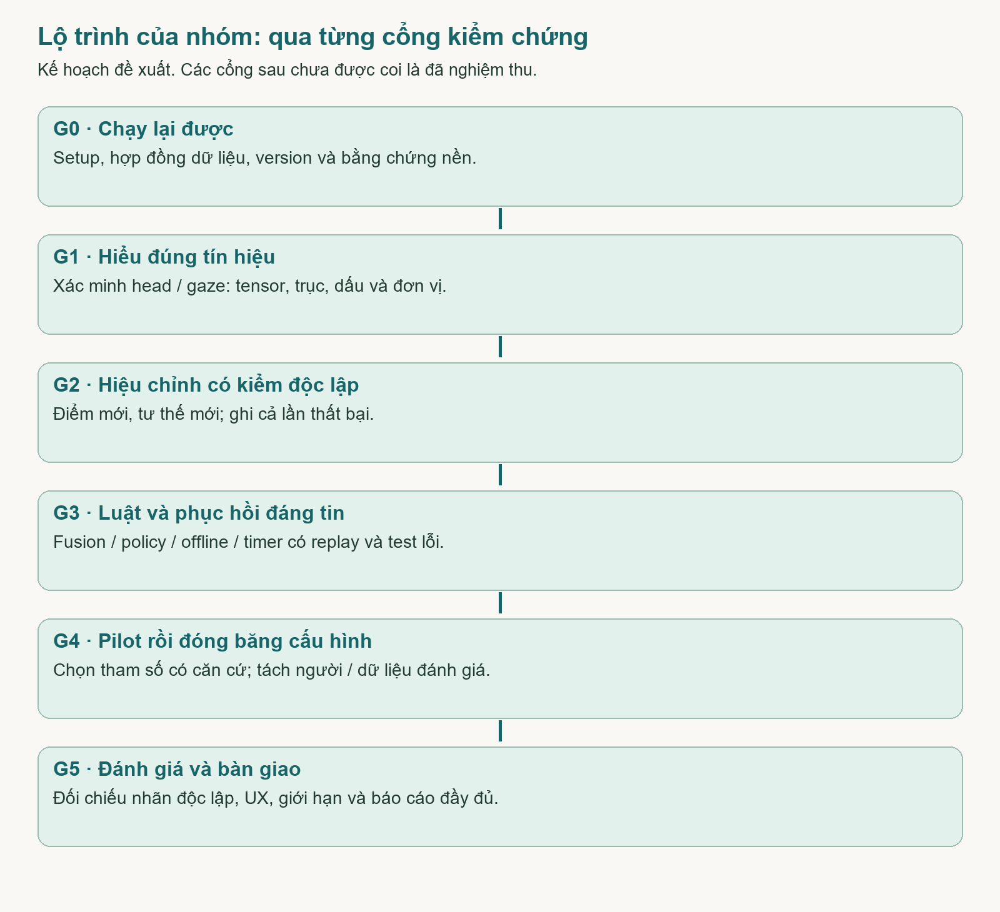

# FocusStudy - Công việc tiếp theo của nhóm

Trích chương 9 của báo cáo ngày 28/10/2026. Đây là kế hoạch đề xuất, chưa phải kết quả đã hoàn thành. Đọc chương 4 trong BAO_CAO_THUYET_TRINH.md trước khi thay đổi model hoặc ngưỡng.

### 9.1 Thứ tự làm tiếp và các cổng cần vượt qua

Mục tiêu tiếp theo là biến prototype có code thành bản demo có bằng chứng đúng loại. Không bắt đầu bằng việc tăng số màn hình hoặc tinh chỉnh ngưỡng cho dễ hiện nhắc. Cần xác minh ý nghĩa tín hiệu, xây dữ liệu tham chiếu độc lập và giải quyết các lỗi state/dữ liệu trước khi đánh giá trải nghiệm người dùng.

| Cổng | Nhóm cần chứng minh | Chỉ chuyển bước khi |
|---|---|---|
| G0 - nền tái tạo được | Máy chạy, phiên bản/model/hash/config rõ; dữ liệu thử tách riêng | Thành viên khác chạy lại được theo README, hiểu giới hạn và quyền dữ liệu |
| G1 - tín hiệu có nghĩa | Trục/dấu/đơn vị/head-gaze mapping và ghép mặt được kiểm | Có log chỉ dẫn, mô tả lỗi, regression và quy ước được review |
| G2 - hiệu chỉnh dùng được | Thu mẫu đúng target và phân biệt điểm mới với ngoài vùng | Có kiểm độc lập, trường hợp thất bại và quyền dùng nhánh hạn chế |
| G3 - logic nhất quán | Detector/fusion/policy/timer/offline/report đúng hợp đồng | Replay và các ca race/lỗi/dữ liệu đều truy vết được |
| G4 - pilot và đóng băng | Ngưỡng/UX được chỉnh trên dữ liệu phát triển | Có căn cứ, version cấu hình và tách dữ liệu đánh giá cuối |
| G5 - đánh giá cuối | Chạy protocol, tổng hợp kết quả thực và giới hạn | Báo đúng mẫu số, lỗi/loại trừ và không dùng dữ liệu minh họa |

Frontend/luồng timer và backend recovery có thể làm song song với kiểm model. Tuy nhiên không chọn ngưỡng cuối trước khi trục và cách hiệu chỉnh được xác nhận, không gọi protocol đã chạy khi mới có bảng kế hoạch. Các gói việc sau là đề xuất phân công dựa trên vai trò trong tài liệu nhóm, cần nhóm thống nhất tải công việc và lịch thực tế.

### 9.2 W01 - Chốt hợp đồng dữ liệu và bảng việc chung

Chủ trì đề xuất: Huy; Trang, Linh và Kha cùng review. Đầu vào là code hiện tại, hai PDF và tab GÁN LABEL. Đầu ra cần là bảng schema/quy ước ngắn, không phải rewrite toàn bộ kiến trúc. Giữ REST/React/SQLite hiện có trừ khi có căn cứ riêng để thay.

| Quyết định cần chốt | Nội dung phải ghi | Tiêu chí hoàn thành |
|---|---|---|
| Frame và signal | session/frame/state_version, đơn vị, raw/relative, validity/reason, thời gian | Người viết frontend và hai adapter giải thích giống nhau |
| Nhãn tham chiếu | Head, gaze target, face condition, activity, stable/transition/uncertain | Không lấy model prediction làm ground truth cho chính nó |
| Event và prompt | Khoảng dấu hiệu khác lời nhắc; nguồn, hướng, evidence, blocked reason | Replay cùng chuỗi cho ra kết quả có thể giải thích |
| Calibration quality | Điều kiện code hiện tại khác điều kiện chất lượng sẽ kiểm | Không có nhãn đã kiểm chứng khi chưa có test độc lập |
| Bằng chứng theo phiên | Code/model/config version, điều kiện máy/người thử ẩn danh | Truy lại được một kết quả về đúng đầu vào và cấu hình |

File liên quan: backend/app.py, backend/policy.py, vision/adapters.py, frontend/src/main.jsx và docs/DECISIONS.md. Definition of Done: có ví dụ một mẫu hợp lệ, một mẫu thiếu, một conflict và một sự kiện; một thành viên khác review, các điểm còn mở được liệt kê rõ.

### 9.3 W02 - Xác minh head: góc, mốc và chiều trục

Chủ trì đề xuất: Linh; Kha kiểm chéo. Đọc Vision.infer và complete_calibration trước khi đổi ngưỡng. Chạy kịch bản một chuyển động tại một thời điểm: nhìn giữa, quay trái, quay phải, cúi, ngẩng, nghiêng; dùng phía người học làm quy ước. Không yêu cầu một góc vật lý cụ thể nếu chưa có dụng cụ đo góc đáng tin.

Đầu ra cần: docs/quy_uoc_goc_head.md hoặc tài liệu tương đương, bảng log theo đoạn và các ví dụ lỗi. Ghi rõ hệ tọa độ, chỉ số ma trận, công thức Euler, ảnh gốc/preview lật và mốc cá nhân. Kiểm thêm mẫu gần biên góc vòng, đổi vị trí camera và người có tư thế tự nhiên khác.

Tiêu chí hoàn thành: chỉ dẫn trái/phải/cúi/ngẩng tạo biến thiên nhất quán ở trường dự kiến; invalid không sinh góc 0; mốc không bị chọn sai do dữ liệu quanh +180/-180; roll không tự thành lý do nhắc. Nếu chỉ có nhãn hướng, báo khả năng phân biệt hướng và độ ổn định, không báo MAE góc vật lý.

File dự kiến sửa khi có căn cứ: vision/adapters.py, hàm calibration trong backend/app.py và test liên quan. Mọi thay đổi phải giữ các sửa lỗi bbox/frame upstream và có regression đi kèm.

### 9.4 W03 - Audit L2CS: mapping, đơn vị, preprocessing và ghép mặt

Chủ trì đề xuất: Kha; Linh kiểm chéo. Đây là việc ưu tiên trước chọn ngưỡng gaze. Đối chiếu model.forward, predict_gaze, GazeResultContainer, checkpoint/training conventions; sau đó thử gaze ngang/dọc khi head gần mốc. Khác tên yaw/pitch là lý do cần audit, chưa phải kết luận được phép đảo tensor ngay.

| Việc phải làm | Đầu ra bàn giao | Tiêu chí hoàn thành |
|---|---|---|
| Truy đường tensor đến field | Bảng output đầu mạng -> biến pipeline -> yaw/pitch API | Có căn cứ code/checkpoint và thử theo hướng, không chỉ suy từ tên |
| Kiểm đơn vị và dấu | Mapping radian/degree và chiều theo người học | Không đổi đơn vị hai lần; không đổi dấu chỉ để demo đẹp |
| Kiểm preprocessing | Mô tả RGB/BGR, crop, resize 224 rồi 448, normalize | Đầu vào đúng bản checkpoint đang dùng, không lật frame gốc |
| Kiểm cùng người/cùng frame | Case một mặt, nhiều mặt, lệch bbox, crop mất mặt | Không chắc thì invalid/limited; không ghép bừa hai người |
| Đo tốc độ bước xử lý | Log thời gian detector/head/gaze/tổng và frame bỏ | Chỉ gọi số đo thực trên cấu hình đã ghi; synthetic smoke tách riêng |

Không sửa trực tiếp .venv như giải pháp bàn giao. Sau khi biết đúng mapping, nhóm mới sửa adapter hoặc lớp tích hợp có version và test. Chưa có bằng chứng thì giữ trạng thái chưa kiểm chứng; không dùng nhánh gaze để đưa ra kết luận chắc chắn.

### 9.5 W04 - Hoàn thiện calibration và kiểm các điểm chưa thu

Chủ trì đề xuất: Linh phụ trách head, Kha phụ trách gaze; Trang làm tương tác target và trạng thái quality. Cần có giai đoạn chờ/giữ mục tiêu hoặc xác nhận người đã sẵn sàng trước khi nhận mẫu; loại đoạn chuyển động, không tự coi mọi frame của target hiện tại là nhìn đúng target.

Đầu ra gồm quy trình thu lại, profile có thống kê chất lượng và báo cáo kiểm held-out. Head cần kiểm mốc/dao động/đổi tư thế; gaze cần điểm mới trên màn hình, các góc màn hình, vở và mục tiêu bên ngoài. Thu tại một số điều kiện ánh sáng/kính khác nhau nếu người thử đồng ý; ghi rõ điều kiện không bao phủ.

Nhóm phải chốt tiêu chí pass/fail trên dữ liệu phát triển và nhu cầu sử dụng. Report này không tự đặt một accuracy hoặc số mẫu tối thiểu mới để gọi là đạt. Nếu trong/ngoài chồng lấn nhiều, cho phép báo không phân biệt đủ tin cậy hoặc tắt quyết định gaze, giữ timer/head còn hợp lệ.

Definition of Done: có kết quả trên điểm không dùng để xây profile; profile failed/limited có lý do; thu lại không giữ nhầm trạng thái cũ; không thành công giả chỉ vì đủ 15 mẫu. Các trường quality mở rộng và dwell hiện là việc cần làm, không phải đã có.

### 9.6 W05 - Tổ chức nhãn độc lập và công cụ replay

Chủ trì đề xuất: cả nhóm; Trang hỗ trợ công cụ, Huy định dạng/export; Linh/Kha review nghĩa nhãn. Bản hiện tại đã cho ghi mốc annotations nhưng chưa có toàn bộ công cụ dựng interval và chấm detector. Cần chốt cách chuyển chuỗi mốc thành đoạn có start/end, cách xử lý đoạn cuối chưa có mốc đóng và mức trễ khi người quan sát bấm nút.

| Loại dữ liệu | Nguồn xác định | Không trộn với |
|---|---|---|
| Nhãn head/hành vi | Kịch bản và người quan sát; uncertain khi không chắc | Góc model tự dự đoán |
| gaze_target | Vị trí được hướng dẫn nhìn; ghi giới hạn của chỉ dẫn | Tọa độ mắt thực đo bằng eye tracker |
| Signal log | Pipeline model và validity/reason | Nhãn tham chiếu hoặc accuracy |
| Detector event | Luật áp lên chuỗi signal theo timestamp | Prompt đã qua cooldown/hoãn |
| Feedback và rating | Người dùng xác nhận ngữ cảnh/đánh giá hữu ích riêng | Nhãn model tự nhận diện hoặc training label mặc định |

Đầu ra cần: format interval có version, bộ replay từ timestamp/signal, test gap/invalid/sai thứ tự, bảng ghép sự kiện một-một và tổng hợp có mẫu số. Dữ liệu dùng chỉnh ngưỡng, kiểm held-out và đánh giá cuối phải được đánh dấu riêng; không tối ưu trên chính tập cuối.

### 9.7 W06 - Làm rõ fusion và chính sách nhắc

Chủ trì đề xuất: Kha phụ trách logic ghép tín hiệu; Huy triển khai policy; Linh/Trang review. Bắt đầu từ sự khác biệt thực tế giữa cổng gaze dưới 15 độ và head_turn trên 25 độ, thay vì chỉ thêm tên sự kiện mới. Cần quyết định giữ raw evidence nào khi gaze bị loại khỏi quyết định, cách đánh dấu chưa đủ tin cậy và cách không tạo hai prompt cho cùng hoạt động.

| Trường hợp phải replay | Điều cần kiểm | Đầu ra cần thấy trong log |
|---|---|---|
| Head quay, gaze cũng lệch | Head được ưu tiên; gaze có thể dùng làm evidence hay bị cổng tư thế loại? | Quyết định rõ và lý do loại/giữ, không giả có fusion |
| Head cúi, gaze xuống | Downward chung và notes chỉ B hoãn nhóm | Không nhắc lại cùng hoạt động qua nhánh khác |
| Head gần mốc, gaze lệch | Nhánh gaze độc lập chỉ khi hợp lệ và hiệu chỉnh dùng được | Event gaze với nguồn/thời gian/evidence |
| Gaze lỗi, head hợp lệ | Giữ head, báo hạn chế gaze | Không vô hiệu hóa cả hai vô cớ |
| Hai nhánh mâu thuẫn | Có quy tắc dùng nhánh được kiểm hoặc quan sát thêm | Trạng thái uncertainty, không bỏ phiếu đo tập trung |
| Stale/tab ẩn/nhiều mặt | Tách thiếu dữ liệu khỏi không quan sát được mặt | Reset phù hợp, không prompt cũ hoặc face-absent giả |

Chốt danh mục tên giữa code và tài liệu: head_turn so với head_turn_sustained, gaze_away so với gaze_away_sustained; data_unavailable/gaze_unavailable là event hay support state. Không đổi tên mà làm mất khả năng đọc log cũ; nếu đổi schema phải có version và hướng dẫn chuyển.

Definition of Done: một sơ đồ quyết định đọc được, case test cho mọi hàng trên, A/B chỉ khác cơ chế đã chốt, prompt liên kết đúng bằng chứng. Không thêm nhãn mất tập trung như một sự thật từ phép cộng góc.

### 9.8 W07 - Bảo toàn timer, offline và dữ liệu

Chủ trì đề xuất: Huy; Trang kiểm qua browser. Backend đã có checkpoint 5 giây/shutdown và idempotency, nhưng chưa tái dựng thời điểm thao tác offline chính xác. Nhóm cần hợp đồng về mốc thời gian/interval, pending queue, thứ tự replay, conflict, logout và chính sách khi backend restart. Đây là thiết kế cần hoàn thành, không được gọi là đã xong chỉ vì retry HTTP thành công.

| Ca lỗi | Kết quả phải chứng minh |
|---|---|
| Offline giữa active -> pause -> resume -> end | Tổng active/break/paused đúng theo quy ước đã chốt, không cộng trùng hoặc đoán đoạn không biết |
| Request được nhận nhưng client mất ACK | Retry cùng event_id không áp hai lần; UI chỉ báo lưu sau xác nhận |
| Đã end ở tab khác rồi replay lệnh cũ | Không hồi sinh phiên; resync có giải thích |
| Hardcrash ngay sau thao tác | Khôi phục có giới hạn mất mát được định nghĩa/đo, không tuyên bố zero-loss nếu chưa đạt |
| Xóa khi worker/pending request chưa xong | Không tái tạo session/log; đúng ownership và lỗi có nghĩa |

Cùng gói này cần hoàn thiện reconciliation/tombstone giữa PDF file và DB, backup/restore cả DB+PDF ở đường dẫn khác, và test nâng cấp schema trên fixture. Không chạy thử xóa/restore lên data thật. Đầu ra là test integration có thời gian biết trước, migration bảo toàn dữ liệu và hướng dẫn phục hồi cho người demo.

### 9.9 W08 - Quyền riêng tư và chất lượng UI trước thử người

Chủ trì đề xuất: Trang về UI; Huy kiểm storage/network; cả nhóm thống nhất thông báo dữ liệu. MediaPipe có metrics sử dụng/hiệu năng theo notice đã dẫn; việc input xử lý tại backend cục bộ không đồng nghĩa mọi dependency không gọi mạng. Không tự thay firewall hoặc đổi model để che log; cần phương án được nhóm xác nhận và kiểm chứng.

Checklist UI: camera từ chối vẫn học được; đồng ý trước mở stream; pause/break/off/tab ẩn/end/rời trang/backend lỗi đóng stream thật; resume/reconnect không tự mở. Kiểm đèn camera/track/request bằng công cụ phù hợp, không chỉ nhìn chữ Camera tắt. Thử modal/keyboard/focus/zoom 200%/reduced motion và Chrome/Edge thực; PDF canvas còn thiếu text layer phải được ghi nhận và cải thiện.

Đầu ra là checklist có người chạy, ngày, máy/browser, ảnh/log và pass/fail. Lỗi phải giữ dữ liệu form, báo chưa đồng bộ đúng nghĩa, không có nút giả hoặc kết quả model cũ hiện lại. Mẫu mới không có không được hiển thị góc 0 như đo được.

### 9.10 W09 - Pilot, chọn cấu hình và đo hiệu năng

Chủ trì đề xuất: cả nhóm. Tài liệu nguồn dự kiến 4 sinh viên pilot và 8 người khác đánh giá cuối; đây vẫn là kế hoạch chưa thực hiện, không phải cỡ mẫu đảm bảo kết luận mạnh. Chỉ tiến hành khi quyền dữ liệu, máy chạy và các cổng tín hiệu/logic cơ bản đã đạt.

Pilot dùng để quan sát khó khăn thao tác, thời điểm nhắc sai, sự chồng lấn vùng gaze, điều kiện thiếu mẫu và tốc độ máy. Ghi thời gian riêng head/gaze/tổng, số frame thử gửi/nhận/bỏ/stale, tỷ lệ hợp lệ từng nhánh, cùng CPU/RAM khi có công cụ đo đáng tin. Không dùng 350 ms scheduler làm FPS đo được; không lấy timing crop đen của smoke làm latency webcam.

Mỗi lần đổi ngưỡng phải ghi cấu hình cũ/mới, lý do, dữ liệu phát triển dùng để quyết định và kết quả replay. Sau pilot, đóng băng code/model/config/protocol; thử lại regression trước đánh giá cuối. Nếu gaze chưa phân biệt được một trường hợp quan trọng, báo giới hạn và thống nhất phạm vi với nhóm/giảng viên, không dàn dựng demo thành công.

### 9.11 W10 - Đánh giá cuối và viết kết quả có thể bảo vệ

Chủ trì đề xuất: cả nhóm; mỗi người kiểm chéo một phần. A và B cùng model, hiệu chỉnh, ngưỡng, cooldown, tác vụ; chỉ B dùng notes để hoãn downward 3 phút. Timer-only là nhánh sản phẩm, không phải baseline A của protocol đã nêu.

Chuẩn bị bài X/Y tương đương và phân bổ thứ tự theo bảng trong PDF nguồn. Tách phiên sử dụng gần tự nhiên khỏi kịch bản kỹ thuật diễn hành vi. Sau mỗi điều kiện hỏi hữu ích/gây phiền/kiểm soát; SUS tổng thể cuối buổi không tự cho biết khác biệt A/B. Nếu quá ít prompt, báo thiếu quan sát, không đổi thành kết quả 0 hoặc cố làm người dùng bị nhắc.

| Câu hỏi đánh giá | Chỉ số phù hợp khi có dữ liệu | Giới hạn cần ghi |
|---|---|---|
| Người dùng có thao tác được không? | Hoàn thành độc lập/có trợ giúp/thất bại, thời gian, lỗi | Có hướng dẫn/giúp đỡ thì phải đánh dấu |
| Detector có phát hiện đúng dấu hiệu không? | TP/FP/FN, precision/recall/F1 từng loại theo interval tham chiếu | Không đồng nhất event với prompt đã bị policy lọc |
| Lời nhắc có hữu ích không? | Rating trên số prompt có rating; phản hồi trên số shown | Notes không tự là không hữu ích; mẫu số 0 là không xác định |
| B khác A thế nào? | Chênh lệch theo từng người, số prompt/mẫu số và nhận xét | Mẫu nhỏ, hiệu ứng thứ tự/tài liệu; ít nhắc chưa chứng minh tốt hơn |
| Góc có chính xác không? | Chỉ báo MAE khi có góc tham chiếu và quy ước khớp | Không có chuẩn góc thì không tạo số accuracy góc |

Đầu ra: dữ liệu đã loại định danh theo kế hoạch, script tổng hợp có thể chạy lại, bảng có số mẫu/loại trừ/lỗi, các kết luận đúng phạm vi. Không tự suy ra tăng thành tích học hoặc đo được sự tập trung trực tiếp.

### 9.12 Ai làm gì ngay ở lượt làm việc tiếp theo?

| Thành viên / vai trò đề xuất | Việc nên nhận trước | Sản phẩm để thành viên khác review |
|---|---|---|
| Trang - frontend/HCI | Hướng dẫn camera/calibration, target dwell/quality states, annotations interval UX; kiểm browser/zoom/focus | Checklist UI có ảnh/log; luồng fail/retry; hướng dẫn thu thử không nhầm nhãn với prediction |
| Huy - backend/storage | Hợp đồng signal/event/interval; offline replay, persistence/migration/backup; schema/audit/CSV | Spec ngắn, integration tests, fixture nâng cấp, quy trình recovery và báo cáo khớp log |
| Linh - head | Xác minh matrix/Euler/trục/dấu, mốc vòng góc, stability/invalid, head replay | Quy ước góc và case đúng/sai/thiếu; không MAE khi thiếu tham chiếu góc |
| Kha - gaze/fusion | Audit tensor mapping/preprocessing/checkpoint, ghép mặt, gaze region/held-out, fusion cases | Bảng mapping có căn cứ, log thử mục tiêu, miền hạn chế, replay cùng/mâu thuẫn hướng |

Review chéo đề xuất: Linh và Kha kiểm model của nhau; Trang và Huy kiểm giao tiếp/UI-state của nhau; cả nhóm duyệt policy và quyền dữ liệu. Không coi phân công là cho phép một người đổi chính sách nghiên cứu hoặc ngưỡng đã đóng băng mà không ghi nhận.

Trong buổi làm việc kế tiếp, nhóm nên hoàn thành G0/W01 và thống nhất ai thu, ai quan sát, ai kiểm log. Mỗi thành viên tạo một đầu việc nhỏ có đầu vào, file dự kiến, đầu ra và test/ảnh/log cần nộp. Không cần chờ toàn bộ model xong mới sửa timer/offline/UI, nhưng không đi thẳng sang đánh giá cuối khi ý nghĩa trục còn chưa rõ.

### 9.13 Hồ sơ bàn giao và điều kiện nhóm được nói đã hoàn thiện

Một gói hoàn thành cần có: mô tả thay đổi và lý do; file/code/config/model version; test có ý nghĩa; dữ liệu/bằng chứng đúng loại; giới hạn; người review; cập nhật báo cáo/handoff. Những bảng trong chương này là checklist công việc đề xuất, không phải biên bản đã làm.

Hồ sơ tối thiểu trước demo nghiệm thu: README chạy lại được trên máy khác; model manifest và quy ước góc; calibration có kiểm độc lập; traceability AT01-AT10; replay cho fusion/policy và lỗi; browser/camera checklist thật; report/CSV/delete/backup khớp dữ liệu; PDF có ảnh/bảng đọc được. Bất kỳ mục nào chưa kiểm phải xuất hiện trong slide và handoff, không để người nghe hiểu thành đã đạt.

Chỉ gọi hoàn thiện theo phạm vi đã chốt khi mọi tiêu chí có bằng chứng phù hợp. Code chạy, 27 test fixture đạt, checkpoint có đủ và một demo nhìn đẹp là các điều kiện hữu ích, nhưng không thay được kiểm chứng model/calibration trên người và đánh giá UX thật.
